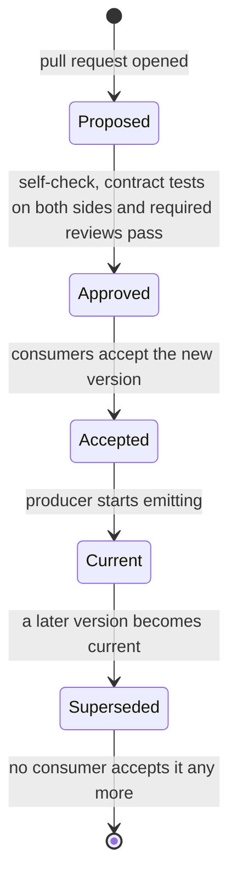
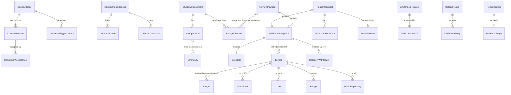

# Functional Specification — U1 contracts

**Inputs:**
- unit-of-work (U1; constraints 1 to 7; "Call Direction Inside the Back End");
- unit-of-work-story-map;
- unit-of-work-dependency;
- requirements;
- components;
- contract-summary (C1 to C11; R-07, R-08, R-18; Amendment D1 note);
- decisions (ADR-002, ADR-004, ADR-008, ADR-011, ADR-012);
- `entities.md` (the source of truth for the contract artifacts);
- `rules.md` (the source of truth for the decisions);
- `functional-design-questions.md`.

This file is the source of truth for the unit's **workflows and state transitions**. U1 is a specification unit (kind `spec`). It owns no requirement directly and supports FR4.10 and every integration contract. It delivers the single authoritative definitions of C1 to C11, the Python and TypeScript types generated from them, and the contract tests that both sides run. B01 `u1-contract-schemas` delivers C2 to C6 and the generation. B02 `u1-api-and-ports` delivers C1 (with C10), C7, C8, C9, C11 and the shared harness; it is marked as security-sensitive in the Bolt plan.

## Acceptance Criteria (U1)

These criteria are U1's own. They come from the unit definition, the Contract Design contract tests, and the Bolt plan's B01 and B02 Definitions of Done, including the mandatory R-18 correction. Each traces to the rules and requirements it exercises.

| ID | Criterion (Given / When / Then) | Rules |
|---|---|---|
| AC1.1 | Given the U1 specs, When the self-check runs, Then every JSON Schema parses, declares `$schema` and `$id` and validates against the 2020-12 meta-schema, the OpenAPI document validates as 3.1, no spec holds a null-valued key, and a second definition of any contract outside U1 is reported | BR1.1, BR1.2 |
| AC1.2 | Given a snapshot, a publish request or a preview payload with one unknown property at any depth, When it is validated in strict mode in Python and in TypeScript, Then both refuse it whole | BR1.3, BR9.3 |
| AC1.3 | Given the C2 schema, When the allow-list conformance test runs, Then its permitted field paths equal the reviewed FR4.10 list; and a change that adds a public field without a version change, an updated allow-list test and a recorded security review fails | BR1.4, BR1.5 |
| AC1.4 | Given a strict-contract message whose `schemaVersion` is not the accepted one, When U8 or U11 receives it, Then the whole message is refused before any other field is read and nothing is written (C3 returns `invalid`); and given a C5 result or C6 record from a later minor version of the same major, When a tolerant consumer reads it, Then it is accepted, while a different major version is refused in both modes | BR1.6 |
| AC1.5 | Given a new snapshot version, When the cascade test runs, Then C3, C4 and the C11 input type pin the new `$id`, U8 and U11 accept both versions, and U9 emits exactly one; and a breaking change without both sides' tests and, for C1 or C3, the owner's review does not merge | BR1.7, BR1.8 |
| AC1.6 | Given a C5 result or a C6 record with a later same-major `schemaVersion` and one unknown additive field, When the fixture runs, Then strict mode refuses it, tolerant mode accepts it and ignores the field, and both language validators give those two declared verdicts; given a C1 response with an unknown additive field (C1 responses carry no `schemaVersion`; C1 is versioned by the OpenAPI document version), Then a tolerant consumer ignores the field; and a producer that emits a field outside its published schema fails | BR1.9, BR1.6, BR9.3 |
| AC1.7 | Given the OpenAPI document, When the closed-body check runs, Then every request-body schema is closed at every level, and an open one fails the check | BR1.10 |
| AC1.8 | Given snapshots with a `http` link, a link or live URL to `github.com`, `gitlab.com`, `bitbucket.org` or `githubusercontent.com` (or any subdomain), an over-size list, or a bad slug or `assetRef`, When they are validated, Then each is refused; and a valid snapshot with `contactEmail` set to null is accepted | BR2.1 |
| AC1.9 | Given fixtures that break each of S1 to S7 (including a lead image repeated in `images` for S7), When U9's builder and U8's receiver check them, Then each is refused by both; and the rule catalogue lists S6a, S8, S9 and S10 as checked by U9 only | BR2.2, BR2.3 |
| AC1.10 | Given a snapshot with an image address, a derivative key, a ticket id, a link-check field or a preview slug added, or a publish request with `imageAddresses`, `downloadAddresses` or `previewSlug`, When it is validated, Then it is refused as an unknown property | BR2.4, BR5.6 |
| AC1.11 | Given a publish request over 5 MB, When U9 prepares it, Then U8 is not invoked and the operation fails with `SNAPSHOT_TOO_LARGE`; and when such a request or a snapshot with 201 exhibits reaches U8, Then U8 returns `invalid` and writes nothing (the over-size part of C3-K18) | BR2.5 |
| AC1.12 | Given a publish request, When U8 receives it, Then it validates first, an invalid request is answered `invalid` whatever its token and leaves the fence unchanged, a valid request below the fence is `fenced` with nothing written, an equal token is allowed only as redelivery of the same `operationId`, a valid higher token is recorded as the new fence before the first write, and `completed` is returned only after all writes, deletions and the invalidation submission | BR3.1, BR3.2 |
| AC1.13 | Given a manifest with a missing, extra or duplicate entry, a missing, extra or duplicate key, or a key that differs by one byte from the key rules, When U8 validates it before any read, Then the request is `invalid` and nothing is written | BR3.3, BR3.4 |
| AC1.14 | Given the storage scope held in U1, When U2's IAM test and U8's validator read it, Then the readable prefixes are `derivatives/` and `files/` only, and `originals/`, `incoming/` and `results/` are denied | BR3.5 |
| AC1.15 | Given the cases C3-K1 to C3-K18, C3-P1, C3-F1 and C3-OK, When U8 and U9 run them, Then each K case is `invalid` with nothing written, the public paths written equal the set computed from the snapshot, and a removed case fails the matrix-completeness check | BR3.6, BR3.7 |
| AC1.16 | Given the OpenAPI document and the reference host built from it in the harness, When the checks run at B02, Then the document is valid with one server and tagged operations, the reference registry equals the document, and an extra undocumented registered route makes the registry check fail (negative control); and the same registry check is listed as re-run against U3's real registry (B06, B07) and each registering unit's host (B10, B14, B21 to B25) | BR4.1, BR4.2, BR4.12, BR4.13 |
| AC1.17 | Given every route except `/health` on the reference host and the four token fixtures from the harness issuer (no token, expired, owner's email on another subject, another issuer), When each is called, Then the verifier sees 401, 401, 403 and 401 respectively with the shared Error body and a spy count of zero, and a deliberately broken reference pipeline makes the same tests fail; and the same tests are listed as re-run against the real host at B07 and per unit | BR4.3, BR4.4, BR4.13 |
| AC1.18 | Given every 4xx and 5xx response in the document, When the lint runs, Then each uses the shared Error body with a code that is on the (status, code) table for its status; the approved bodyless success responses (PATCH project 200, link repository 200, attach image 200, attach attachment 200, PUT line-up 200, retry 202) pass; the shared 401, 403, 429 and 500 are on every operation (health has 200, 429 and 500); a route-specific 403 (AI codes on suggestions) uses the same Error shape; and the `303` from `POST /projects` is the only other documented no-body response | BR4.5, BR4.6, BR4.7 |
| AC1.19 | Given every operation and every documented response status, When the harness drives the unit's real registered handler into that response, Then the observed status, content type and body match the document; an undocumented status, code pair or body shape fails (and negative controls with such a handler make the check fail); a documented status that no case provokes fails; and a stub or reference handler is recorded in the evidence ledger as `reference` and never counted as agreement | BR4.8, BR4.13 |
| AC1.20 | Given the address-field register and the C1, C2 and C4 schemas, When the scan runs, Then the approved schemas pass with exactly the enumerated candidates (the upload authorization, the preview image and download addresses, the C2 public-link fields by name, the listed free-form allowances), `Exhibit.links` and `Repository.linkedProjectId` are not candidates, and every other candidate fails; and the four negative fixtures (an unlisted uri property, an innocuously named uri property, a signed address in a free-form object, and a hidden fourth download channel) each fail the scan | BR4.9 |
| AC1.21 | Given the draft and line-up edit operations, When the lint runs, Then each requires `If-Match` and documents 409 and 428; and `GET /health` returns exactly `{"status":"ok"}`, is the only operation without a security requirement, and returns no other information | BR4.10, BR4.11 |
| AC1.22 | Given a preview payload, When U11 validates it, Then the payload and its snapshot are valid, the addresses are only in the two maps with the required key forms, and a missing address for a required image or download shows no preview | BR5.1, BR5.2 |
| AC1.23 | Given a candidate with no title, no lead image, an image without alt text, or no slug, When the preview is requested, Then the answer is 422 `PREVIEW_BLOCKED` with the blockers; and a candidate that lacks only rights or live-URL approval previews normally | BR5.3 |
| AC1.24 | Given link-check fixtures, When they are validated, Then the label is one of the three, `finalAddress` has no userinfo, query or fragment, and a C5 field name in the snapshot schema is refused; and with a fake clock, a U6 that exceeds 15 seconds is a bound violation, an invoke error or 20-second timeout gives "Not reachable" with a reason, and an exhibit with several candidate URLs causes exactly one invoke | BR5.4 |
| AC1.25 | Given upload results for a valid image, a valid attachment and a rejected upload, When they are checked, Then the image has exactly the variant rule's derivatives, the attachment has its `fileKey` with the right extension, the rejected upload has neither, and the `assetRef` equals the one in the key | BR5.5 |
| AC1.26 | Given the back-end package, When the boundary test runs, Then modules interact only through the ports, the ports module imports nothing from U3 to U11, and every port has one provider, named consumers and a conforming fake | BR6.1, BR6.2 |
| AC1.27 | Given the guard methods, When they run with the fake unit of work, Then every write goes through the supplied unit of work, a write outside it fails, and if a later acceptance step fails after a guard wrote, the fake reports zero committed writes | BR6.3 |
| AC1.28 | Given an assembly with no U4 and no U9 module registered, When U3 attaches an image or file and lists projects, Then the default check refuses every attachment, every project reports the derived status Draft, and the host still serves `/health` and U3's own routes without importing U4, U5 or U9 | BR6.4, BR6.6 |
| AC1.29 | Given a GitHub error, a rate limit or a rename while reading visibility, When `access_facts` answers, Then the repository is `unconfirmed` with no name, URL or licence | BR6.5 |
| AC1.30 | Given an `assetRef` and a key part, When keys are built and parsed, Then each of the five patterns round-trips, a non-key string does not parse, and the file-type table maps every value to exactly one other, with no image type as a `fileType` | BR7.1, BR7.3 |
| AC1.31 | Given image widths 1, 479, 480, 481, 959, 960, 961, 1599, 1600 and 1601, When the variant rule runs in Python and in TypeScript, Then both give the same set of 2, 4 or 6 keys (below 480: `w480` at the pixel width) | BR7.2 |
| AC1.32 | Given the page paths and public routes, When U7's link targets and U8's object keys are computed for the same fixture, Then each page path maps to exactly one object key, the image and download paths follow the resolver rule, and an unmapped path fails | BR7.4, BR7.5 |
| AC1.33 | Given labels with upper case, non-ASCII letters, U+0130 and U+212A, runs of symbols, 200,000 hyphens, alternating hyphens and letters, an empty result and a result cut at 60, When the download name is computed in Python and in TypeScript, Then both give the same name made of `[a-z0-9-]` and one `.`, U+0130 and U+212A become `-`, and the run time stays within `DOWNLOAD_NAME_BUDGET` (set in NFR Design; the scaling check applies until then) | BR7.6 |
| AC1.34 | Given the generated renderer types, When the surface test and the negative fixtures run, Then the exports are exactly the approved surface, an invalid snapshot or a missing or unknown `previewSlug` throws `RenderInputError` before any output, `requiredImages` and `requiredDownloads` equal the manifest computation, and an unresolved reference throws | BR8.1, BR8.2, BR8.3, BR8.4 |
| AC1.35 | Given the shared renderer fixtures, When U7, U8 and U11 run their suites, Then Node and browser output are identical, the purity and marking cases pass, and a runner that omits a shared fixture fails the completeness check | BR8.5 |
| AC1.36 | Given the specs, When the types are generated, Then the Python types pass mypy and the TypeScript types pass `tsc --noEmit` under strict settings, regenerating gives identical output, and a hand-edited generated file or a duplicate contract definition fails | BR9.1, BR9.2 |
| AC1.37 | Given every fixture with its expected verdict per mode, When both language validators run them from a clean checkout against the reference host and fakes, Then they agree with the declared verdict in each mode, and each unit runs the cases for every contract it provides or consumes | BR9.3, BR9.5 |
| AC1.38 | Given the specs and fixtures, When the secret scan and withheld-value check run, Then they find only placeholder text, `.invalid` hosts and generated identifiers | BR9.4 |
| AC1.39 | Given U0's local C2 schema, variant and download-name helpers, output scan and snapshot validator, When the U1 fixtures run against them, Then any difference in verdict is reported; and once an owning unit takes over slice code, the duplicate-definition check fails if a local copy remains | BR9.6 |
| AC1.40 | Given attempt A (token 5) that passed validation and then stalls, and attempt B (token 6) that was accepted and completed, When A resumes and attempts each kind of write and deletion, Then each is refused at the fence-conditional write, A returns `fenced`, and the public set equals B's with nothing of A present and nothing of B changed or recreated; and a direct conditional write with a stale token is refused | BR3.8, BR3.7 |
| AC1.41 | Given the contract register, When the register check runs, Then version states move only in the order Proposed, Approved, Accepted, Current, Superseded, a skipped transition fails, a Current version that some consumer does not list fails, a contract with two Current versions fails, and a constant, prefix list or allow-list path defined outside the register fails | BR1.11 |

## Workflows

**W1 — Define or change a contract and bump its version** (B01, B02; any later change).
1. A pull request edits a spec in U1.
2. The self-check runs (BR1.2) and the duplicate-definition check runs (BR9.2).
3. The change is classified as additive or breaking (BR1.8). A narrowed or renamed field, or a changed meaning, is breaking.
4. IF a public snapshot field is added THEN the pull request raises the version, updates the reviewed allow-list and the PB-02 allow-list test, and records an independent security review (BR1.4, BR1.5).
5. IF the snapshot version changes THEN C3, C4 and the C11 input type take new versions that pin the new `$id` (BR1.7).
6. IF the change is breaking on C1 or C3 THEN the owner reviews it. Both sides' contract tests and the contract summary are updated in the same pull request (BR1.8).
7. The version, the consumers' modes and accepted versions, the allow-list and the constants are recorded in the contract register, and the version moves through the lifecycle below. The register check tests each transition (BR1.11).

**W2 — Generate types and run the contract tests on both sides** (B01, B02; every CI run).
1. The generator produces the Python types and the TypeScript types from the specs (BR9.1).
2. Regeneration must equal the committed output, and mypy and `tsc --noEmit` must pass (BR9.1, BR9.2).
3. The harness loads each fixture with its expected verdict (BR9.3, BR9.5).
4. The Python validators and the TypeScript validators each run every fixture; the verdicts must agree with the expected verdict and with each other.
5. Each unit runs the cases for every contract it provides or consumes, against stubs and fakes where the counterpart does not exist yet.
6. Any failure blocks the merge; there is no live service involved (BR9.5).

**W3 — Build and validate the snapshot, U9 to U8** (contract view of C2 and C3; ADR-002, ADR-004).
1. U9 builds the snapshot by its projection (allow-listed fields only) and checks S1 to S7 and the U9-only rules (BR2.2, BR2.3).
2. U9 validates the snapshot against C2 (BR1.3, BR2.1, BR2.4) and builds the asset manifest from the key rules (BR3.3, BR3.4).
3. IF the serialized request is over 5 MB THEN U9 does not invoke U8 and the operation fails as `SNAPSHOT_TOO_LARGE` (BR2.5).
4. U9 sends the request with the operation id and a new, higher attempt token (BR3.1).
5. U8 checks the version in strict mode (BR1.6), then validates the request against C3 and C2, the size bound, S1 to S7, and the manifest entries (BR2.5, BR3.3, BR3.4), all before any read.
6. Only a request that passed step 5 records its token: U8 sets the fence to the higher of the stored value and the token. A lower token gives `fenced`; an equal token is accepted only for the same operation id; an invalid request never advances the fence (BR3.1).
7. U8 computes the public paths from the snapshot (BR3.6) and writes exactly them plus the renderer's static assets. Every write and every deletion is conditional on the fence still equalling this token, so a stalled older attempt is refused at the write and stops (BR3.8). It returns `completed` only after the invalidation is submitted (BR3.2).
8. Any other status, or a timeout, is a failed attempt, and U9 decides what follows (BR3.2).

**W4 — Preview payload with a separate image-address map, U9 to U11** (C4; ADR-008).
1. The owner asks for the preview of a project through the Studio API (BR4.3).
2. U9 projects the candidate. IF it cannot project to a valid C2 snapshot THEN the answer is 422 `PREVIEW_BLOCKED` with the blockers (BR5.3).
3. U9 builds the candidate snapshot: the last committed snapshot with this exhibit replaced (BR5.1).
4. U9 asks the media port for owner-only, short-lived addresses for each required image variant and format, and for each attachment (`preview_address`, `preview_download_address`), and puts them in the two maps, never in the snapshot (BR2.4, BR5.2).
5. U11 validates the payload and the snapshot (BR5.1), then renders with the preview resolver. IF an address is missing THEN the renderer throws and no preview is shown (BR5.2, BR8.4).
6. The result goes to a sandboxed frame marked "Preview — not public" and is never written anywhere. The payload never reaches U8 (BR5.6).

**W5 — Port wiring with fail-closed defaults** (C7; "Call Direction Inside the Back End").
1. U3 starts its host with no modules registered. It serves `/health` and its own routes, its attach check refuses every attachment, and the project list reports the derived status Draft because no publication module is registered (BR6.2, BR6.4, BR6.6).
2. U4, U5 and U9 register their routes through the route registry. Each route runs the same pipeline (BR4.3, BR4.12).
3. U4 provides the real attach check. Until then the refusing default stays in place (BR6.4).
4. U9 and U5 reach Projects and the repository catalogue only through ports. The guards take U9's unit of work, so acceptance and commit run in one transaction (BR6.1, BR6.3).
5. During preparation U9 reads repository facts, the link-check result and the attachment inventory once, and freezes them into the ticket. A GitHub failure yields `unconfirmed` (BR6.5).
6. U10 reads each owner's records only through `export_records` (BR6.2).

**W6 — OpenAPI-versus-handler agreement check** (R-18 point 3; R-08).
1. The harness reads the document and builds the reference host from it: a spy route for every operation, and the pipeline contract (BR4.13). U1 is a specification unit; the real registry and OwnerAccess pipeline arrive in U3's Bolts B06 and B07, after B02.
2. **At B02:** it lints the document: structure, single server, tags, error bodies, shared responses, the `(status, code)` table, bodyless successes, `If-Match` and health (BR4.1, BR4.5, BR4.6, BR4.7, BR4.10, BR4.11, BR4.12).
3. At B02 it compares the reference registry with the document (BR4.2), and for each route except `/health` it sends the four non-owner calls to the reference pipeline and counts spy invocations (BR4.4).
4. At B02 it runs the negative control: a deliberately broken reference pipeline must make steps 3 fail (BR4.13). It runs the address-field scan with its four negative fixtures (BR4.9).
5. **Deferred, re-run against real hosts:** the registry and non-owner tests at B06 and B07; and, as each unit's routes land (U4 B10, U5 B14, U9 B21 to B25, U3 B08 and B09), the agreement check: for each operation and documented status, the real handler is driven into the response and its status, content type and body are validated against the document, plus the value check for address-like strings (BR4.8, BR4.9).
6. The harness records evidence per operation as none, reference or real. A stub or reference handler driven into its documented response is evidence `reference` and is never counted as agreement; unprovoked documented statuses are reported (BR4.8).

**W7 — Manifest validation (R-07)** (C3; U8 before any read).
1. U8 receives the request and validates version and schema (BR1.6, BR1.3).
2. It checks that the manifest holds exactly one entry per referenced asset (BR3.3).
3. For each entry it generates the expected keys from the key rules and the snapshot, and compares byte for byte (BR3.4, BR7.1, BR7.2, BR7.3).
4. Any failure returns `invalid` with nothing written (BR3.7). IAM stays the first layer: U8's role can read only `derivatives/` and `files/` (BR3.5).

**W8 — Upload result and key layout** (C6, C8).
1. The owner's browser uploads one object under `incoming/{assetRef}/upload` using a single-use authorization (BR4.9).
2. The isolated processor validates the bytes. It writes the derivatives and the original, or the validated file, under the key layout, deletes the raw object, and writes `results/{assetRef}.json` (BR5.5, BR7.1).
3. U4's module ingests the record when the asset status is read or an attach is checked.
4. U9 later names the derivative keys in a manifest (BR3.4), and U8 reads only those keys.

## State Machine — Contract version lifecycle

Text fallback:
- a pull request opens a version as Proposed;
- when the self-check, both sides' contract tests and any required review (BR1.5, BR1.8) pass, it is Approved;
- once the consumers (U8, U11 and the others) list it as accepted, it is Accepted; a consumer then holds the old and the new version (BR1.7);
- when the producer (U9 for C2, C3 and C4) starts emitting it, it is Current;
- when a later version becomes current, it is Superseded;
- when no consumer accepts it any more, it leaves the lifecycle.

Only the order matters: the producer never emits a version that a consumer does not accept (BR1.6, BR1.7). Which release removes a superseded version from the accepted sets is decided in the pull request that does so.

## Entity Relationships (derived from `entities.md`)

The embedded definitions (`Sections`, `Category`, the enumerations and the `instances` catalogues) and the rule entities (`SemanticRule`, `VariantRule`, `FileTypeMapping`, `PageObjectMapping`, `PublicRoute`, `DownloadNameRule`, `StorageKeyPattern`, `PortInterface`, `ErrorCodeEntry`, `NoBodyException`, `PipelineStage`, `RenderOptions`, `AssetResolver`) are omitted from the diagram for readability. They are in `entities.md`.

## Rules Summary (derived from `rules.md`)

- **Versioning and strictness:** one definition each, BR1.1; well-formed specs, BR1.2; closed strict contracts, BR1.3; the FR4.10 allow-list, BR1.4; field addition is a reviewed version change, BR1.5; strict and tolerant validation modes and version refusal, BR1.6; the cascade and rollout order, BR1.7; semantic versions and breaking changes, BR1.8; lenient contracts, BR1.9; closed request bodies, BR1.10; the contract register and ordered version states, BR1.11.
- **The snapshot (C2):** structural rules, BR2.1; semantic rules S1 to S7, BR2.2; U9-only rules, BR2.3; no private address, BR2.4; size bound, BR2.5.
- **The publish request (C3, R-07):** the operation id, the fencing token and the fence rules, BR3.1; result statuses, BR3.2; manifest exactness, BR3.3 and BR3.4; IAM prefix limits, BR3.5; paths from the snapshot, BR3.6; the K-test matrix and the added fence cases, BR3.7; the stalled-attempt guarantee at the conditional write, BR3.8.
- **The Studio API (C1, C10, R-08, R-18):** valid document, BR4.1; registry equals document, BR4.2; one pipeline, BR4.3; non-owner rejection, BR4.4; the shared Error body, BR4.5 to BR4.7; the agreement test, BR4.8; the three channels and the address-field register, BR4.9; `If-Match`, BR4.10; health, BR4.11; U3's host only, BR4.12; the B02 reference host and what is deferred to the real hosts, BR4.13.
- **Preview, link check, upload (C4 to C6):** BR5.1 to BR5.6.
- **Ports (C7):** BR6.1 to BR6.6, including the fail-closed attach check, BR6.4.
- **Keys, variants, paths, names (C8, C9):** BR7.1 to BR7.6.
- **Renderer (C11):** BR8.1 to BR8.5.
- **Generation, harness, replacement of U0's stand-ins:** BR9.1 to BR9.6.

## Where U0's Local Versions Are Replaced

U0 implemented thin local forms of parts of C2, C8, C9 and C11 for the walking slice (Amendment D1). U1 formalises the single authoritative definitions, and the owning units replace the local forms in their own Bolts (BR1.1, BR9.6). Until then the U1 fixtures also run against the local forms, so a difference is found early.

| U0 local form | Replaced by | When, and by whom |
|---|---|---|
| `web/slice-renderer/src/c2-schema.json` (the slice's C2 schema) | The C2 schema in U1 and the TypeScript type generated from it | U7 and U11, when they take over slice code; U8 and U9 for validation |
| `web/slice-renderer/src/variants.ts` (variant rule and download name) | U1's variant rule (BR7.2) and download-name rule (BR7.6); both languages share fixtures | U7 and U8. The slice trims hyphens after the cut as BR7.6 does, but it lower-cases with Unicode `toLowerCase`, which differs on U+0130 and U+212A; BR7.6 supersedes it with the ASCII fold, and both inputs are in the shared fixtures |
| `scripts/scan_output.py` (the allow-list scan of the public output) | The scan against U1's allow-list and fixtures (BR1.4, BR2.4) | U9 and U8, for the PB-02 export scan |
| `backend/portfolio_api/slice/snapshot.py` (snapshot builder and validator) | U1's generated Python types and validator (BR9.1, BR9.3) | U9 |
| The slice's `contracts/README.md` placeholder | The U1 contract artifacts | U1 (B01, B02) |

The slice's C2 consumption stays a read of the approved schema; U0 adds no contract, so U1 changes no contract by formalising it.

## Assumptions & Open Questions

- **Specification only.** U1 has no runtime. It produces specs, generated types, fixtures and a harness. The behaviour each rule requires is implemented by the unit named in the rule, and the harness is how U1 proves both sides agree.
- **Draft shapes pending.** The `Project`, `ProjectPatch`, inventory and ticket shapes are fixed in the Functional Design of U3, U9 and U11. Until then BR1.10 lists them as pending and the document carries placeholders. No other contract waits on them.
- **Tracked clarification owed to the contract summary.** BR7.6 needs one line added to `contract-summary.md` (C9 Download name) at its next change: ASCII-only lower-casing, and hyphens trimmed again after the 60-character cut. The approved summary is not edited here.
- **Residual fence window.** The fence check and the public write cannot be one atomic step across two stores (BR3.8); NFR Design and Infrastructure Design choose the mechanism that narrows it.
- **Platform-generated responses.** Responses created by the API entry point before the host runs are outside the OpenAPI document; U2's Infrastructure Design owns them. The shared Error body (BR4.5) therefore covers every response the host produces.
- **Open contract points stay with their stages.** The per-attempt time budget (C3), the exact rate limits (C5), the pixel limit (C6), the public JavaScript budget (C9) and the real origins (C1, C9) are set in NFR Design and Infrastructure Design (contract-summary Open Questions). None blocks this stage.
- **Decisions reused, not reopened.** The versioning, strictness, R-07, R-08 and R-18 decisions are the approved ones; this design only makes them testable.
