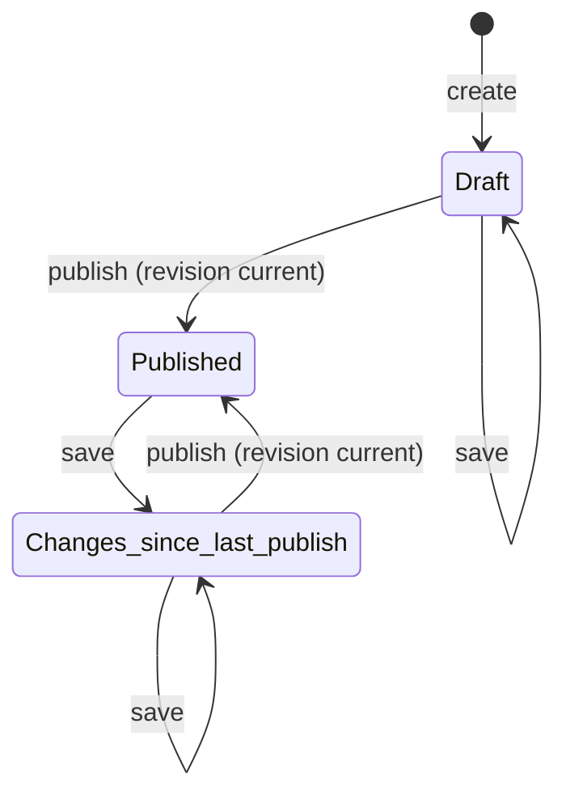
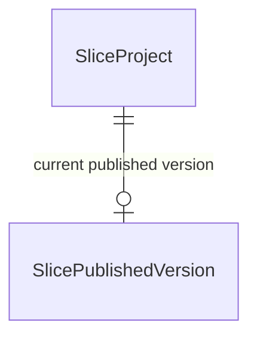

# Functional Specification — U0 walking-slice

**Inputs:**
- unit-of-work (U0; Amendment D1);
- unit-of-work-story-map;
- requirements;
- components;
- contract-summary (C2, C9, C11);
- `entities.md` (the source of truth for data);
- `rules.md` (the source of truth for decisions);
- `functional-design-questions.md`.

This file is the source of truth for the slice's **workflows and state transitions**. The slice is delivery-only (Amendment D1). It demonstrates create, save, preview and publish to a static page locally. S0 also delivers the repository layout and the baseline CI, which merge to `main`.

## Acceptance Criteria (slice)

These criteria are U0's own. They come from `bolt-plan.md` Phase A, and each traces to the rules and requirements it exercises.

| ID | Criterion (Given / When / Then) | Rules |
|---|---|---|
| AC0.1 | Given no token, an unverifiable or expired token, a wrong issuer, audience or algorithm, or a valid token with another subject, When any slice API route except health is called, Then it answers 401 (or 403 for the other subject) and no handler runs | BR1.1 |
| AC0.1a | Given the fake issuer is configured, When the API starts outside explicit local mode, Then it refuses to start | BR1.3 |
| AC0.2 | Given a synthetic non-local artifact containing the `AIDLC_LOCAL_ONLY_FAKE_IDP` marker, the fake issuer URL or private-key material (a negative fixture shipped with S0), When the S0 guard runs, Then it fails; and a clean artifact passes | BR1.2 |
| AC0.3 | Given a project at revision N, When a save based on N−1 arrives, Then it is refused with 409 and nothing changes | BR2.1 |
| AC0.4 | Given an empty or over-long title, a summary over 1200 characters, or a slug already in use, When the owner saves, Then it is refused with the reason; and once published, the slug cannot be changed | BR2.2 |
| AC0.5 | Given a draft that has never been published, When the owner previews it, Then the shared renderer shows it marked "Preview — not public" and nothing is written to the output folder | BR4.1, BR4.2 |
| AC0.6 | Given the owner confirms Publish for revision N, When revision N is still current, Then a C2-valid snapshot is frozen and the static page is served locally, showing the title and summary escaped | BR3.1, BR3.2, BR3.3, BR4.2 |
| AC0.7 | Given the owner confirms Publish for a revision that is no longer current, When the request arrives, Then it is refused and nothing is written | BR3.1 |
| AC0.8 | Given a published project, When the owner saves a change, Then its status reads "Changes since last publish", and the public page is unchanged until the next Publish | BR3.4, BR3.1 |
| AC0.9 | Given the public output folder, When the allow-list scan runs over every file (HTML, attributes, JSON, file names), Then it finds only values derived from C2 fields and the placeholder content; and a failure partway through Publish (in rendering, in the transaction, or in the swap) leaves the previous output and the previous current version in place, consistent with each other | BR3.1, BR3.2, BR3.3 |
| AC0.10 | Given a pull request, When CI runs, Then the aggregate check runs, executes the checks for the changed paths, and fails if any of them fails | BR5.1 |
| AC0.11 | Given a pull request touching a listed security-sensitive path, When there is no review record with its current patch identity, Then the check fails; and after a content-identical rebase it still passes | BR5.2 |

## Workflows

**W1 — Create a project** (S1, S3).
1. The owner, signed in through the local fake identity provider, opens the Studio page and enters a title.
2. The API checks the owner (BR1.1) and validates the title (BR2.2).
3. It proposes a unique slug and stores the project at revision 1, with status Draft (BR3.4).

**W2 — Save** (S1, S3).
1. The owner edits the title or summary.
2. The page sends the change with its base revision.
3. The API checks the owner and the revision (BR1.1, BR2.1). On success it stores the change and returns revision N+1; on conflict it returns 409, and the page tells the owner to reload.

**W3 — Preview** (S2, S3).
1. The page asks for the candidate snapshot of the current revision.
2. The page renders it with the shared renderer in preview mode, inside a sandboxed frame marked "Preview — not public" (BR4.1).
3. Nothing is written to the output folder.

**W4 — Publish** (S2, S3).
1. The owner confirms Publish. The request names the revision the owner reviewed.
2. The API checks the owner, then checks that the revision is still current (BR3.1).
3. It builds the C2 snapshot and validates it (BR3.2).
4. It renders the pages with the shared renderer in public mode.
5. It renders into a temporary folder (BR3.3). A render failure deletes the folder and changes nothing.
6. The revision check and the SlicePublishedVersion write happen as one conditional transaction (BR3.1).
7. Only after that commit does it swap the temporary folder into place, in one rename. If the swap fails, a compensating transaction removes the new version record, restoring the previous current version, and Publish reports the failure. The folder and the recorded version therefore always agree. The status becomes Published (BR3.4).

**Mapping a SliceProject to C2.** A Publish builds the snapshot like this:
- `title`, `summary` and `slug` come from the project;
- `leadImage` and `images` hold the bundled fixture image, with its real width, height and alt text;
- `sections` is `{}`;
- `attachments`, `links`, `badges` and `publicRepositories` are `[]`;
- `featured` is `false`, so `featuredOrder` is `[]`;
- `primaryCategory` is absent, so `categories` is `[]`;
- `publishedAt` is the commit time;
- `site` comes from local configuration (placeholder owner name and GitHub URL; `contactEmail` is `null`).

**Repository layout** (S0; the owning units deepen it):
- `backend/`: the Python package host;
- `web/`: the TypeScript workspace, holding the renderer, the Studio and the public site;
- `contracts/`: a placeholder for U1;
- `infra/`: a placeholder for U2;
- `local/`: the development stack, including `local/fake-idp/`;
- `.github/`: workflows and `security-sensitive-paths.txt`;
- `docs/security-reviews/`: review records.

S1 to S3 add their code only on `slice/walking-slice`.

**W5 — CI baseline** (S0; rules BR5.1, BR5.2, BR1.2). On every pull request, one aggregate required check runs, skipping components by changed path:
- format, lint and type check;
- tests with coverage;
- gitleaks;
- the dependency audit;
- CodeQL;
- the content-bound security-review check over the provisional security-sensitive paths;
- the fake identity provider guard (BR1.2).

**W6 — Slice check** (S3). `make slice-check` runs W1 to W4 end to end against the local stack, then runs the allow-list scan (AC0.9). It exits non-zero on any failure.

## State Machine — SliceProject status (derived)

Text fallback:
- create → Draft;
- a save keeps Draft as Draft;
- publish moves Draft to Published;
- a save moves Published to "Changes since last publish";
- publish moves "Changes since last publish" back to Published.

Take-down is not part of the slice; U9 owns it.

## Entity Relationships (derived from `entities.md`)

## Rules Summary (derived from `rules.md`)

- **Owner only, with a verified token:** BR1.1; the fake issuer is refused outside local mode: BR1.3.
- **The fake identity provider never ships:** BR1.2.
- **Optimistic revisions:** BR2.1.
- **A title and a unique slug:** BR2.2.
- **Publish only on explicit confirmation:** BR3.1.
- **The C2 allow-list:** BR3.2.
- **The output equals the last snapshot:** BR3.3.
- **Derived status:** BR3.4.
- **Marked, unwritten preview through the shared renderer:** BR4.1.
- **Escaping:** BR4.2.
- **The aggregate CI check:** BR5.1.
- **The content-bound security-review check:** BR5.2.

## Studio Page (minimal; S3)

**One page, in four states:**
- signed out;
- the project list, with a "New project" action;
- the editor (title, summary, Save);
- preview, with the "Publish" confirmation.

**Errors shown:**
- 401/403, with "Sign in again";
- 409 `STALE_REVISION`, with "Reload: this project changed";
- 422, with the reason.

The page holds no secrets, and makes no authorization decision of its own. It keeps the access token in memory only, never in local or session storage, sends it in the `Authorization` header, and discards it on sign-out or reload.

## Assumptions & Open Questions

- **Thin by design.** U3, U7, U8, U9 and U11 specify the full behaviour in their own Functional Design.
- **Never deployed.** The slice runs only on a local stack.
