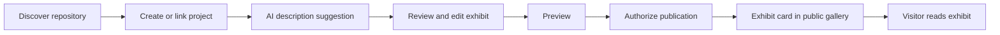

# Scope Document — Architect's Portfolio, First Release

Inputs: the approved intent statement (`ideation/intent-capture/intent-statement.md`), the charter (`docs/CHARTER.md`), and the answers in `scope-definition-questions.md`. No feasibility assessment (`feasibility-assessment`) or constraint register (`constraint-register`) was produced for this workflow (the Feasibility stage is not part of the approved plan), so neither was consumed.

## Release Goal

The first release proves the whole curation loop on real work: Michael signs in to the private Studio, finds a GitHub repository, turns it into an exhibit with an AI-suggested description he reviews, previews it, and explicitly publishes it, after which visitors see it on the public site at michael.broadfoot.consulting. The three seed exhibits (AI Arcade, STARS, Mom's Recipe Box) are published this way. [intent-statement] [charter §8] [Q6]

## In Scope

### Private Studio (owner only)

| Capability | Source |
|------------|--------|
| Sign in to the Studio; no one else can get in | charter §8 |
| Discover an existing GitHub repository | charter §8 |
| Create a project, or link a repository to an existing project | charter §8 |
| Edit the exhibit's public presentation: the narrative sections (inspiration, design challenges, architectural decisions, implementation, outcomes, lessons learned) | charter §3, §8 |
| Add an image gallery (screenshots, CAD renders, workshop photos) | Q2 |
| Add links out to the GitHub repositories, live application or demo | Q2 |
| Attach build-it-yourself material (downloadable design files, cut lists, instructions) | Q2 |
| Generate an AI description suggestion, then review, edit, accept or discard it; suggestions show the source evidence they were drawn from | charter §5, §8 |
| Preview the exhibit exactly as visitors will see it | charter §8 |
| Save changes so they persist | charter §8 |
| Explicitly authorize publication; nothing becomes public without that act, and discovering private material never makes it public | charter §4, §5, §8 |

### Public site (all visitors)

| Capability | Source |
|------------|--------|
| An exhibit page for each published project | Q1 |
| A visually compelling gallery of published exhibits as the public entry point: image-led exhibit cards, so visitors encounter the creations immediately (not a text list). Minimal for this release: the three seed exhibits as three image-based cards is sufficient | Q1; owner refinement at approval (2026-10-10) |
| No visitor accounts, no behavioral tracking, no advertising analytics, no visitor profiling | charter §3; intent-statement (Success Metrics) |

### Launch

| Capability | Source |
|------------|--------|
| Site live at michael.broadfoot.consulting, with mike.broadfoot.consulting permanently redirecting to it (paths and query strings preserved) | Q6; charter §2 |
| Every deployment and DNS change happens only after Michael's explicit approval | charter §7 (autonomy policy) |

## Out of Scope (this release)

| Item | Why | Source |
|------|-----|--------|
| Google Drive and Trimble/SketchUp connectors | GitHub is the only source in the first release | intent-statement (Q8) |
| Invitation-only and other non-public access modes; serving invited people | Invited people are a later-version audience | intent-statement (Q8, Q10) |
| Visitor appearance customization (theme, accent colours, layout preferences) | Deferred | intent-statement (Q8) |
| Richer gallery features (featured work, grouping by discipline, filtering) | The first release uses a minimal image-card gallery | Q1; owner refinement at approval |
| Aggregate per-exhibit request counting, and any other visitor analytics | Deferred; no visitor analytics are needed for this release | Owner refinement at approval (2026-10-10) |
| Bringing in projects beyond the three seed exhibits | The charter limits the first sprint to the seed examples | charter §8 |
| More than one AI-assisted workflow | The charter asks for one useful AI workflow first | charter §5 |

## Value Stream

How the first release turns Michael's existing work into something a visitor sees:

<!-- Text fallback: Discover repository, then create or link project, then AI description suggestion, then review and edit exhibit (narrative, images, links, build material), then preview, then authorize publication, then the exhibit appears as an image card in the public gallery, then a visitor opens and reads it. -->

The value lands at the last two steps; every earlier step exists to make reaching them low-effort and safe. [intent-statement (Problem Statement)]

## Success Measures for This Release

Carried forward from the approved intent statement:

- All three seed exhibits are published. [intent-statement]
- Owner time from a discovered repository to a published exhibit is measured; its target is set after the first slice is in use. [intent-statement]

The intent statement's third measure, aggregate per-exhibit request counts, is deferred by the owner's decision at Scope Definition approval: no visitor analytics are needed for this release. This document supersedes that metric for the first release.

## Future Roadmap (documented, not in this release)

Recorded so later work starts from it rather than re-deciding:

| Item | Source |
|------|--------|
| Visitor appearance customization (theme, accent colours, layout preferences), client-side only | charter §3; intent-statement (Q8) |
| Richer gallery: featured work, grouping by discipline, filtering | Q1; owner refinement at approval |
| Invitation-only and other non-public access modes, serving invited people | charter §3; intent-statement (Q8, Q10) |
| External connectors: Google Drive, Trimble/SketchUp | charter §4; intent-statement (Q8) |
| Privacy-respecting aggregate request counts, if ever wanted | owner refinement at approval |

## Deadline

None set. The release is scheduled by readiness, not by date. [Q5]

## Assumptions & Open Questions

- **Image source (open, owner answered "Not yet defined").** Whether exhibit images are uploaded in the Studio, pulled from the GitHub repository, or both. Proposed default for Requirements Analysis: upload in the Studio, since it works for workshop photos and CAD renders that are not in any repository. [assumption]
- **Build order (open, owner answered "Not yet defined").** The backlog is sequenced dependency-first along the charter's slice order, with the publish boundary built before anything public. Delivery Planning confirms the final order. [assumption]
- **Withdrawing a published exhibit.** The charter requires explicit publication but says nothing about un-publishing. The backlog lists it as a Should Have, because a public site with no way to retract a mistake is risky. Requirements Analysis confirms it. [assumption]
