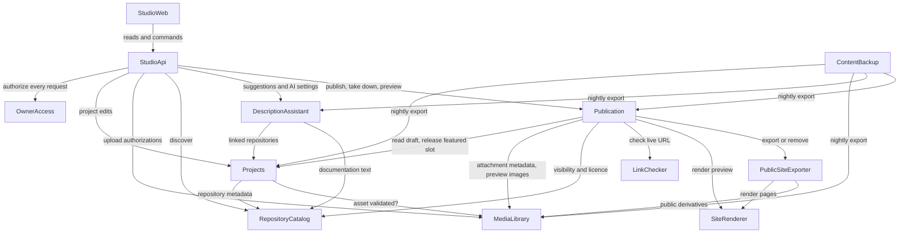

# Domain Design — Components

**Inputs:**
- requirements — `../requirements-analysis/requirements.md`, FR1–FR10 and NFR1–NFR17, including Amendment A1 to A1.2;
- team-practices — `../practices-discovery/team-practices.md`, as affirmed in `team.md` and `project.md`;
- the approved Refined Mockups, especially P4, the approved-publication snapshot;
- decisions D-01 to D-28 and P-01 to P-06;
- the answers in `domain-design-questions.md`.

The decisions behind this catalogue are ADR-001 to ADR-012 in `decisions.md`, and `traceability.json` maps every functional requirement to a component or entity.

This document names the **building blocks we write code for**. It does not decide deployment topology (Units Generation does), the tech stack beyond the charter's constraints, or NFR patterns (NFR Design and Infrastructure Design do). Databases, storage, the CDN, Auth0, GitHub and the AI provider appear only as external dependencies.

## Component Catalogue

```yaml
components:
  - name: StudioWeb
    summary: The owner's private Studio in the browser — projects, discover, editor, preview, publish, take-down, featured order, activity.
    behaviour: >
      Renders only after sign-in; holds no secrets and makes no authorization decision of its own (FR1.2).
      Warns before leaving the editor with unsaved changes (FR4.6) and keeps unsaved edits so they survive
      re-authentication (FR1.4; the storage mechanism is fixed in NFR Design). Shows the empty state with
      "New project" and "Discover a GitHub repository" (FR3.5), status words rather than colour alone,
      the "Preview — not public" marking (FR6.1), and the take-down notice that copies held elsewhere cannot be withdrawn (FR8.4).
      Escapes all owner and AI text (FR4.5). Uploads go directly to storage using authorizations from the API (FR4.8).
    responsibilities:
      - Studio screens S1–S9 as approved in Refined Mockups
      - Local unsaved-edit recovery and the leave guard
      - Direct-to-storage uploads using issued authorizations
    depends_on:
      - component: StudioApi
        interaction: every read and command; sign-in tokens are attached to each call
        style: sync
    dependents: []
    external_dependencies:
      - name: Auth0 (owner sign-in with MFA)
        kind: third-party-api
        purpose: Hosted sign-in and second factor; returns the token presented to the API
      - name: Private object storage
        kind: object-store
        purpose: Target of direct uploads made with a single-use upload authorization
    entities:
      - name: LocalEditDraft
        identifier: projectId
        attributes: [projectId, baseRevision, fieldValues, capturedAt]
        references:
          - entity: Project
            owned_by: Projects
            relationship: each local draft holds unsaved edits to one project at a known revision

  - name: StudioApi
    summary: The Studio's server boundary — authenticates every request, enforces rate limits, and routes to the domain components.
    behaviour: >
      No Studio operation runs without OwnerAccess confirming the caller is the owner (FR1.2, NFR1);
      a refused request returns 401 or 403 and changes nothing. The single exception is the health
      endpoint (`GET /health`) used by post-deploy smoke checks (NFR11): it is unauthenticated, rate-limited,
      reads no domain data, and returns only a fixed status body with no version, configuration, project
      or owner information. Every other route requires the owner. Applies the NFR16 request-rate limits to
      AI suggestions, upload authorizations and the Publish/Update preparation that triggers link checks,
      returning 429 before any provider call, authorization or outbound request. Composes flows that
      span components so the dependency graph stays acyclic (ADR-011): Discover joins the repository
      list with project links; inserting a suggestion passes its recorded provenance to Projects;
      an upload authorization is requested from MediaLibrary only after Projects confirms the project exists.
      Serves preview only to the owner (FR6.2). Logs errors with a request id and no secrets or personal data (NFR11).
    responsibilities:
      - Request authentication via OwnerAccess on every operation
      - Rate limits (NFR16), error mapping, request ids
      - The one unauthenticated route, a data-free health endpoint
      - Composition of cross-component Studio flows
    depends_on:
      - component: OwnerAccess
        interaction: verify the caller is the configured owner before any operation
        style: sync
      - component: Projects
        interaction: create, read, edit and list projects; link repositories; categories and featured line-up
        style: sync
      - component: MediaLibrary
        interaction: issue upload authorizations and confirm uploaded files
        style: sync
      - component: RepositoryCatalog
        interaction: list and search the owner's repositories for Discover
        style: sync
      - component: DescriptionAssistant
        interaction: request suggestions; read and change AI spend and provider approvals
        style: sync
      - component: Publication
        interaction: statuses, preview, Publish/Update preparation and confirmation, take-down, featured order, activity log
        style: sync
    dependents:
      - component: StudioWeb
        interaction: every Studio read and command
    external_dependencies: []
    entities: []

  - name: OwnerAccess
    summary: Decides whether a request comes from the single configured owner.
    behaviour: >
      Validates the identity token's signature, expiry, audience and issuer, then admits the caller only
      when both the issuer and the immutable subject ID equal the configured owner values (FR1.1).
      Email, display name and other user-editable claims never establish ownership. A look-alike account,
      a foreign issuer, or an expired or malformed token is refused. MFA is enforced at the identity provider
      (FR1.3); where the token carries second-factor evidence, OwnerAccess also requires it (mechanism fixed in NFR Design).
      Holds no data of its own; the owner identity values are configuration.
    responsibilities:
      - Token validation and owner matching
      - The single authorization rule used by every Studio operation
    depends_on: []
    dependents:
      - component: StudioApi
        interaction: authorize each Studio request
    external_dependencies:
      - name: Auth0 (issuer metadata and signing keys)
        kind: third-party-api
        purpose: Verify token signatures and the issuer
    entities: []

  - name: Projects
    summary: The owner's working record of every project and its exhibit draft.
    behaviour: >
      A project can be created with only a title (FR3.1) or from a repository; a repository already linked
      opens its project rather than creating a duplicate (FR2.3). Every save carries the revision it was
      based on, and a save based on an older revision is refused with a conflict (FR3.4). Each save
      increments the draft revision, which is all Publication needs to derive "Changes since last publish" (ADR-003).
      Holds the exhibit text (title, summary, six narrative sections), links, access metadata (live URL,
      access requirement, phone suitability; FR4.10), the "Rights review complete" and "Live URL authorized"
      flags (FR10.6, FR10.7), the images and attachments chosen for the exhibit with alt text and lead image,
      the primary category and featured flag (FR9.7, FR9.8), and the provenance of AI-inserted text (FR5.2, FR7.2).
      Links are typed (demo, documentation, other); a repository is linked only through a RepositoryLink, never
      as a free-form link, and Publication blocks any free-form link that points at a repository host (ADR-002; FR4.3).
      Accepts an image or attachment only after MediaLibrary confirms it passed validation and was uploaded for this
      same project; an asset belonging to another project is refused (FR4.8).
      Every saved change to a project's draft increments its revision in the same write. This covers:
      - text, links, access metadata and repository links;
      - images, alt text, lead image and attachments;
      - category and featured flag;
      - the rights-review and live-URL flags;
      - text provenance.
      Provides the revision guard Publication uses when accepting a confirmation (ADR-012). Inside the acceptance
      transaction, the guard succeeds only if the draft revision still equals the reviewed revision. It records the
      accepted operation in `publicationGuard` by a conditional write to the project record, so a concurrent save
      conflicts with it, and it does not change the revision. Publishing therefore leaves the status "Published", while
      a save that lands after acceptance makes revision N+1 and "Changes since last publish". On take-down, the release of
      the draft featured slot is written by Projects inside Publication's commit transaction.
      Likewise, every change to the draft FeaturedLineup increments its revision, including a slot released by take-down.
      A line-up guard, the counterpart of the revision guard, lets a featured-order confirmation be accepted only while that
      revision is unchanged. It records the accepted operation in the line-up's `publicationGuard` by a conditional write,
      without changing the revision, so a concurrent line-up edit conflicts with it.
      Enforces at most five featured projects, drafts included (FR9.7). No topic tags (FR4.7).
    responsibilities:
      - Project and exhibit draft lifecycle, with optimistic concurrency
      - The revision guard used atomically when a publication is accepted
      - Repository links, exhibit composition (images, alt text, lead, attachments)
      - Category reference data, category assignment, draft featured line-up
      - Rights-review and live-URL authorization flags
      - Provenance of AI-originated text
    depends_on:
      - component: RepositoryCatalog
        interaction: read repository metadata when creating a project from, or linking, a repository
        style: sync
      - component: MediaLibrary
        interaction: confirm an uploaded asset passed validation and belongs to this project before attaching it
        style: sync
    dependents:
      - component: StudioApi
        interaction: project reads and edits
      - component: DescriptionAssistant
        interaction: read a project's linked repositories
      - component: Publication
        interaction: read the draft to prepare, preview and publish; revision and line-up guards at acceptance; release the featured slot on take-down
      - component: ContentBackup
        interaction: nightly export of project data
    external_dependencies:
      - name: MongoDB Atlas
        kind: database
        purpose: Project, draft and composition records
    entities:
      - name: Project
        identifier: projectId
        attributes: [projectId, title, revision, summary, narrativeSections, links, liveUrl, accessRequirement, phoneSuitability, rightsReview, liveUrlAuthorized, featured, publicationGuard, createdAt, updatedAt]
      - name: RepositoryLink
        identifier: linkId
        attributes: [linkId, projectId, githubRepositoryId, nameAtLink, linkedAt]
      - name: ExhibitImage
        identifier: exhibitImageId
        attributes: [exhibitImageId, projectId, assetId, altText, caption, position, isLead]
        references:
          - entity: MediaAsset
            owned_by: MediaLibrary
            relationship: each exhibit image shows one validated image asset
      - name: ExhibitAttachment
        identifier: exhibitAttachmentId
        attributes: [exhibitAttachmentId, projectId, assetId, label, position]
        references:
          - entity: MediaAsset
            owned_by: MediaLibrary
            relationship: each exhibit attachment offers one validated file asset
      - name: Category
        identifier: categoryId
        attributes: [categoryId, slug, name, position]
      - name: CategoryAssignment
        identifier: assignmentId
        attributes: [assignmentId, projectId, categoryId, primary]
      - name: FeaturedLineup
        identifier: lineupId
        attributes: [lineupId, orderedProjectIds, revision, publicationGuard]
      - name: TextProvenance
        identifier: provenanceId
        attributes: [provenanceId, projectId, field, suggestionId, providerId, sourceRepositoryIds, insertedAt]
        references:
          - entity: Suggestion
            owned_by: DescriptionAssistant
            relationship: each provenance record names the suggestion whose text the owner inserted

  - name: MediaLibrary
    summary: Owns every uploaded byte — authorization, validation, conversion, private originals and metadata-free public derivatives.
    behaviour: >
      Issues short-lived, single-use upload authorizations to the owner only, with the size limit, allowed
      type and the project bound in (FR4.8); StudioApi requests one only for a project that Projects confirms exists.
      An asset is reported as attachable only to the project it was authorized for. After upload it validates content by file signature, never by name or declared type:
      images JPEG, PNG, WebP, HEIC/HEIF up to 10 MB, with the pixel limit checked before any full decode and decoding
      under memory and time limits; HEIC keeps only the oriented primary image (FR4.2). Attachments PDF, SKP, FCStd,
      DXF, STL, ZIP, VSDX up to 50 MB; ZIP-based checks read only the central directory and the named entry, enforce
      uncompressed-size and ratio limits, never extract to disk, and parse XML with DTDs and external entities disabled (FR4.4).
      Extracts attachment metadata and ZIP entry lists under the same limits, reporting "could not be read" on failure (FR7.2).
      Produces public derivatives only on request from export: images re-encoded with all metadata removed (FR4.2).
      Originals never leave private storage (FR4.9, NFR2). A security-sensitive path (team practice).
    responsibilities:
      - Upload authorization and post-upload content validation
      - HEIC conversion, decode limits, archive and XML safety checks
      - Attachment metadata and entry listing for the Publish confirmation
      - Metadata-free public image derivatives; private originals
    depends_on: []
    dependents:
      - component: StudioApi
        interaction: issue upload authorizations; report validation results
      - component: Projects
        interaction: confirm an asset is validated and was uploaded for the same project before it is attached
      - component: Publication
        interaction: attachment metadata for the confirmation; owner-only preview image addresses
      - component: PublicSiteExporter
        interaction: metadata-free image derivatives and attachment bytes for export
      - component: ContentBackup
        interaction: nightly export of asset records
    external_dependencies:
      - name: Private object storage (versioned)
        kind: object-store
        purpose: Originals and derivatives; never an origin of the public site (NFR2, NFR10)
      - name: MongoDB Atlas
        kind: database
        purpose: Asset and upload-authorization records
      - name: Image and archive decoding libraries
        kind: other
        purpose: Signature checks, HEIC conversion, re-encoding, safe ZIP and XML reading
    entities:
      - name: MediaAsset
        identifier: assetId
        attributes: [assetId, projectId, kind, detectedType, byteSize, pixelWidth, pixelHeight, originalKey, derivativeKeys, validationStatus, documentMetadata, archiveEntries, uploadedAt]
        references:
          - entity: Project
            owned_by: Projects
            relationship: each asset was uploaded for one project
      - name: UploadAuthorization
        identifier: authorizationId
        attributes: [authorizationId, projectId, kind, allowedType, maxBytes, objectKey, expiresAt, usedAt]
        references:
          - entity: Project
            owned_by: Projects
            relationship: each authorization permits one upload for one project

  - name: RepositoryCatalog
    summary: Read-only view of the owner's GitHub repositories — listing, metadata, visibility, licence and documentation text.
    behaviour: >
      Uses only a read-only credential scoped to the owner's repositories and to metadata, README and documentation
      files (FR2.2); it has no write path, so discovery or linking can never change a repository or publish anything (FR2.5).
      Lists repositories with name, visibility as text, last-updated date, searchable by name (FR2.1). Reports
      visibility as public, private or unconfirmed: any error, rate limit or rename yields "unconfirmed", which
      callers treat as private (FR4.10 fail closed). Reports GitHub being unreachable as a distinct, retryable
      condition (FR2.4). Returns documentation text to the description assistant marked as untrusted (FR5.6). Stores nothing.
    responsibilities:
      - Repository listing and search
      - Visibility and licence facts, failing closed
      - Documentation text retrieval for AI evidence
    depends_on: []
    dependents:
      - component: StudioApi
        interaction: Discover listing and search
      - component: Projects
        interaction: repository metadata when linking
      - component: DescriptionAssistant
        interaction: README and documentation files of linked repositories
      - component: Publication
        interaction: visibility and licence read at Publish and Update
    external_dependencies:
      - name: GitHub API
        kind: third-party-api
        purpose: Repository metadata, visibility, licence, documentation files
      - name: AWS SSM Parameter Store
        kind: other
        purpose: Read-only GitHub credential (NFR3)
    entities: []

  - name: DescriptionAssistant
    summary: Drafts exhibit text from a project's linked repositories, behind a provider-independent port and the owner's spending and privacy approvals.
    behaviour: >
      Offers suggestions only for a project with at least one linked repository (FR5.1). Before any provider call
      it checks, in order: the owner has approved AI spending and this month's limit is not reached (FR5.8);
      if any source repository is private or unconfirmed, the configured provider is approved for private content (FR5.9).
      Repository text is delimited as untrusted data, cannot alter the instructions, and the model has no tools (FR5.6).
      Each suggestion records its source files, source repositories and the provider used (FR5.2, FR5.9) and never
      changes exhibit text itself. A failure, a 60-second timeout or malformed output yields "No suggestion this time"
      with no change (FR5.7). Provider credentials are read server-side only (FR5.5). Providers are adapters behind
      one port, so they can be swapped by configuration (FR5.4); which provider and framework is fixed in NFR Design.
    responsibilities:
      - Suggestion generation through a provider-independent port
      - Spend approval, monthly limit, provider approval for private content
      - Suggestion records with sources and provider
    depends_on:
      - component: Projects
        interaction: find the project's linked repositories
        style: sync
      - component: RepositoryCatalog
        interaction: fetch documentation text and visibility of those repositories
        style: sync
    dependents:
      - component: StudioApi
        interaction: suggestion requests and AI settings
      - component: ContentBackup
        interaction: nightly export of suggestions and AI settings
    external_dependencies:
      - name: AI provider API (chosen in NFR Design)
        kind: third-party-api
        purpose: Generate suggestion text
      - name: AWS SSM Parameter Store
        kind: other
        purpose: Provider credentials (FR5.5, NFR3)
      - name: MongoDB Atlas
        kind: database
        purpose: Suggestions, approvals, usage counts
    entities:
      - name: Suggestion
        identifier: suggestionId
        attributes: [suggestionId, projectId, providerId, sourceFiles, sourceRepositoryIds, includesPrivateContent, text, outcome, createdAt]
        references:
          - entity: Project
            owned_by: Projects
            relationship: each suggestion was drafted for one project
      - name: AiSpendPolicy
        identifier: policyId
        attributes: [policyId, spendApproved, monthlyLimit, approvedAt]
      - name: AiProviderApproval
        identifier: providerId
        attributes: [providerId, approvedForPrivateContent, dataUseTermsReference, approvedAt]
      - name: AiUsageMonth
        identifier: month
        attributes: [month, suggestionCount]

  - name: LinkChecker
    summary: Checks whether one live URL is reachable, under the NFR17 SSRF rules, and returns a result without storing anything.
    behaviour: >
      Accepts one https URL on port 443 without userinfo or non-canonical IP literals, parsed by one canonical parser.
      Connects only to globally routable unicast addresses (IANA special-purpose registries as an allow-list,
      IPv4-mapped forms normalized; any refused address refuses the URL), pins the validated address, keeps TLS
      validation with the original hostname, re-validates every redirect (at most 3), uses GET or HEAD with identity
      encoding, 5 s per hop, 15 s overall, 256 KB read after decoding, never renders or loads subresources, and sends
      no credentials (NFR17). Returns exactly one label — "Reachable", "Not reachable" or "Refused (non-public address)" —
      with the sanitized final address and whether a sign-in page was detected (FR10.5). Logs host, address, decision and
      reason, never the body. Has no database, secret or private-network access (ADR-005).
    responsibilities:
      - SSRF-safe reachability check of one URL
      - Result labels and sign-in detection
    depends_on: []
    dependents:
      - component: Publication
        interaction: check the exhibit's live URL when Publish or Update is opened
    external_dependencies:
      - name: Public internet and DNS
        kind: other
        purpose: Resolve and request the owner-entered URL
    entities: []

  - name: Publication
    summary: The only path to the public site — prepares the owner's confirmation, binds it to the reviewed revision and inventory, freezes approved published versions, runs every publication operation in one site-wide sequence, builds the public site model, and keeps the activity log.
    behaviour: >
      Derives each project's status from its draft revision and its publication record (ADR-003; FR3.2, FR7.5).
      PREPARATION. Preparing Publish or Update reads draft revision N and builds the full inventory (FR7.2): text sections,
      AI-originated text, images, included files with their metadata and ZIP entries, links, live-URL check result
      (via LinkChecker, one URL per exhibit), repository visibility and licence read now (unconfirmed treated as private),
      any private repository that informed the text, featured status, primary category, outstanding rights review or
      unauthorized live URL. It freezes the candidate PublishedVersion projected from revision N at this moment, so what
      can be published is exactly what the owner is shown. Both go into a single-use, expiring ConfirmationTicket with a
      digest of the inventory (ADR-012). Every ticket also records its BASIS, the public state it was prepared against:
      - the exhibit's last accepted operation (counting operations accepted but not yet run);
      - for featured changes, the published featured order version and the set of live featured exhibits.
      Take-down and "Update featured order" are prepared the same way. A featured-order ticket also freezes the exact
      candidate order shown to the owner, and binds to the draft line-up revision it was taken from.
      Every change to the draft line-up increments that revision, including the release of a slot on take-down.
      BLOCKERS (FR7.3, FR10.6, FR4.3, FR9.7): Publish is blocked when
      - the title is empty;
      - there is no lead image;
      - an image lacks alt text;
      - a rights review is outstanding;
      - a free-form link points at a repository host (repositories are published only through repositories confirmed public);
      - publishing the exhibit as featured would put more than five exhibits in the published carousel.
      ACCEPTANCE (ADR-012). Confirming sends the ticket id, the inventory digest that was displayed, and a confirmation id
      generated once per confirmation by the Studio. A repeat with the same confirmation id is the same confirmation.
      In one atomic transaction, Publication:
      - checks that the ticket is unused and unexpired, that the digest matches, and that the exhibit's last accepted
        operation still equals the ticket's basis (so an Update prepared before an accepted take-down is refused);
      - calls the Projects revision guard (draft revision still N), or for a featured-order ticket the Projects line-up guard
        (line-up revision unchanged);
      - marks the ticket used, takes the next site-wide sequence number and records the PublicationOperation.
      If any check fails, nothing is accepted and the owner is told the exhibit changed since review and must review again.
      A repeat of the same confirmation (same ticket and confirmation id) returns the operation already accepted (FR7.6).
      A different confirmation presenting an already-used ticket is refused.
      RUN-TIME BASIS CHECK. When an operation starts, every operation accepted before it has either committed or failed.
      It re-checks its state-dependent preconditions against that committed state, and if any no longer holds it fails
      as "basis changed — review again", with no public change. The preconditions are:
      - the action is still legal for the exhibit's publication state;
      - the published carousel would not exceed five;
      - for "Update featured order", the published order version and the set of live featured exhibits still equal its basis.
      The acceptance check refuses early; the run-time check is the guarantee.
      PROJECTION (ADR-002). A PublishedVersion holds only allow-listed public fields (FR4.10):
      - derived badges;
      - the owner-included live URL, only if authorized where required and excluded by default for a project linked to
        a private repository (FR10.7);
      - repositories confirmed public, with licence;
      - the primary category frozen with its slug, name and position.
      Private repository names, URLs and IDs never enter it (FR4.3, D-15). Confirmation evidence stays in the ticket and operation.
      SEQUENCING (ADR-004). Every operation that changes public pages runs in one site-wide sequence, one at a time,
      in acceptance order: publish, update and take-down of any exhibit, and "Update featured order". The sequence
      therefore also keeps each exhibit's own operations in confirmation order (FR7.8). Each operation starts from the
      last committed public state (its base generation), applies its own change and builds the complete public site model.
      ATTEMPTS AND FENCING. Every attempt, whether a first run, an automatic retry or a manual retry, takes:
      - a lease on the sequence, which outlasts the attempt's maximum execution time;
      - a new fencing token from a strictly increasing site-wide counter.
      An attempt starts only after the previous attempt's lease has expired or been released, so two attempts never run
      at once. The attempt exports with its token. PublicSiteExporter refuses any write whose token is lower than the
      highest token it has accepted, recorded in a site-wide fence that is never deleted. The attempt then commits, in one
      transaction and only if its token still holds the lease and the site generation still equals its base generation:
      - the new publication state and featured order;
      - the next site generation;
      - its ActivityEntry;
      - for a take-down, the release of the exhibit's draft featured slot through Projects.
      A stalled earlier attempt therefore can neither write nor commit over newer state. Because a manual retry gets a new
      token, it is never blocked by tokens used by later operations.
      ABANDONED ATTEMPTS. An attempt can stop without reporting (a crash, or a timeout past its lease), leaving some of
      its objects in public storage. When a lease expires without a commit or a completed restore, a recovery attempt runs
      before anything else in the sequence. It does not wait for a later operation: lease expiry triggers it, and a
      periodic check (interval set in NFR Design) backs that up. The recovery attempt:
      - takes a new lease and a higher token;
      - marks the abandoned attempt failed;
      - restores public storage to the last committed model (FR7.8).
      Its fresh token fences out the abandoned attempt. An abandoned attempt counts as one of its operation's attempts,
      including against a take-down's automatic-attempt budget.
      RETRY. A retry re-runs the same accepted operation, and only when no later operation for that exhibit has succeeded;
      otherwise the operation is marked superseded. A failed attempt restores public storage to the last committed
      generation, under its own token, and is shown with a retry. A manual retry of a Publish, Update or featured-order
      operation is allowed only while its ticket is unexpired. After that the owner prepares again, so visibility, rights
      and link checks are fresh. A take-down retry is always allowed, because removing content needs no fresh checks.
      FIVE MINUTES. NFR Design sets the per-attempt time budget and the number of automatic take-down attempts so that an
      operation, the work queued ahead of it and its automatic attempts finish within the 5-minute guarantees (FR7.4, FR8.2).
      An operation that still fails is reported as failed rather than as complete; the guarantee is never shown as met
      when it was not.
      TAKE-DOWN FAILURE. A failed take-down is retried automatically, ahead of later operations, within that budget.
      When its automatic attempts are exhausted it is marked failed, releases the lease, and the sequence moves on to the
      next operation, so the queue is never blocked by it.
      While the exhibit is still public, its status stays as derived (Published or Changes since last publish), and the
      Studio shows a persistent "Take-down failed — still public" alert with a retry on the Projects list and the editor.
      The failure is recorded in the activity log. Nothing is reported as taken down until the operation commits.
      The alert clears only when one of these happens:
      - a take-down of that exhibit commits;
      - a later Publish or Update of it supersedes the failed take-down. That confirmation states "A take-down of this
        exhibit failed; confirming keeps it public", and the activity log records the supersession.
      FEATURED ORDER (ADR-010). PublishedFeaturedOrder lists the published featured exhibits, in order.
      - Publishing or updating an exhibit as featured, when it is not already in the order, appends it at the end.
      - Publishing or updating it as not featured removes it.
      - A take-down removes it and releases its draft slot in Projects; it is not restored on a later publish.
      - "Update featured order" publishes exactly the candidate order frozen in its ticket, provided its run-time basis
        check passes.
      In every case the other entries keep their relative order (FR8.2, FR9.7).
      PUBLIC SITE MODEL. Publication is the only builder of the public site model: the current PublishedVersion of every live
      exhibit, the PublishedFeaturedOrder, and the categories derived from the frozen primary categories of live exhibits.
      Categories with no live exhibit are absent. The exporter and the renderer receive nothing else.
      Preview builds a candidate version by the same projection and renders it, marked "Preview — not public", for the owner only (FR6).
      A candidate becomes eligible only with its content, rights, live-URL and publication approvals (FR10.1).
      Records every publish, update, take-down and featured-order change, and every failure, in the activity log (FR7.7).
    responsibilities:
      - Publish, Update, take-down and featured-order preparation, blockers and confirmation inventory
      - Confirmation tickets bound to the reviewed revision and inventory; atomic acceptance
      - The approved-publication snapshot (PublishedVersion) and its allow-list projection
      - The public site model (the only builder)
      - One site-wide, fenced, idempotent operation sequence; failure restore; take-down retry and alert
      - Published featured order semantics
      - Status derivation, owner-only preview, activity log
    depends_on:
      - component: Projects
        interaction: read the draft and its composition; revision guard at acceptance; release the featured slot on take-down
        style: sync
      - component: MediaLibrary
        interaction: attachment metadata and entries for the inventory; owner-only preview image addresses
        style: sync
      - component: RepositoryCatalog
        interaction: read visibility and licence at Publish and Update preparation
        style: sync
      - component: LinkChecker
        interaction: check the live URL when the confirmation is prepared
        style: sync
      - component: SiteRenderer
        interaction: render the owner-only preview from a candidate version
        style: sync
      - component: PublicSiteExporter
        interaction: export or restore public pages and assets for a sequenced operation, after the owner's confirmation has been accepted
        style: async
    dependents:
      - component: StudioApi
        interaction: statuses, preview, preparation, confirmation, take-down, featured order, activity
      - component: ContentBackup
        interaction: nightly export of publication records and the activity log
    external_dependencies:
      - name: MongoDB Atlas
        kind: database
        purpose: Publication records, versions, tickets, operations, site state, activity log
    entities:
      - name: PublicationRecord
        identifier: projectId
        attributes: [projectId, state, currentVersionId, lastOperationId, failedTakeDown]
        references:
          - entity: Project
            owned_by: Projects
            relationship: each project has at most one publication record
      - name: PublishedVersion
        identifier: versionId
        attributes: [versionId, projectId, sourceRevision, title, summary, narrativeSections, images, attachments, links, liveUrl, badges, publicRepositories, primaryCategory, featured, confirmedAt]
        references:
          - entity: Project
            owned_by: Projects
            relationship: each published version is a frozen, allow-listed projection of one project revision
      - name: ConfirmationTicket
        identifier: ticketId
        attributes: [ticketId, projectId, kind, preparedRevision, candidateVersion, candidateOrder, inventory, inventoryDigest, basis, lineupRevision, preparedAt, expiresAt, usedByOperationId]
        references:
          - entity: Project
            owned_by: Projects
            relationship: each ticket records what the owner reviewed for one project (none for a featured-order ticket)
      - name: PublicationOperation
        identifier: operationId
        attributes: [operationId, sequence, ticketId, confirmationId, projectId, kind, status, attemptCount, currentAttemptToken, baseGeneration, acceptedAt, completedAt, failureReason]
      - name: PublicSiteState
        identifier: siteId
        attributes: [siteId, generation, nextSequence, fenceCounter, leaseToken, leaseExpiresAt, lastCommittedOperationId, committedAt]
      - name: LinkCheckRecord
        identifier: checkId
        attributes: [checkId, projectId, requestedUrl, label, finalAddress, signInDetected, crossDomainRedirect, checkedAt]
      - name: PublishedFeaturedOrder
        identifier: orderId
        attributes: [orderId, orderedProjectIds, version, publishedAt]
      - name: ActivityEntry
        identifier: entryId
        attributes: [entryId, at, projectId, action, outcome, operationId]

  - name: SiteRenderer
    summary: Turns a public site model into the public pages — home, catalog, category, exhibit and not-on-display — with no access to Studio data.
    behaviour: >
      A pure transformation: input is the public site model that Publication builds — PublishedVersions of live exhibits,
      the published featured order, and the categories derived from their frozen primary categories (or one candidate
      version for preview); output is pages and their client assets. Home shows the featured
      carousel only when a published exhibit is featured, then categories with published exhibits, then the gallery
      (FR9.1); exhibit pages omit absent blocks (FR9.2); unknown or empty addresses get the not-on-display pages (FR9.3,
      FR9.8). Footer with GitHub, a plain email link and copyright (FR9.4). All text is escaped (FR4.5). No third-party
      origin, inline script or tracking (FR9.5, NFR9, NFR15). Implements the approved crafted-studio tokens and the
      accessible, non-auto-advancing carousel (FR9.6, FR9.7, NFR8). Preview adds the permanent "Preview — not public" marking (FR6.1).
    responsibilities:
      - Public page templates and client assets
      - Category, featured, gallery and badge presentation
      - Preview rendering with the preview marking
    depends_on: []
    dependents:
      - component: Publication
        interaction: render the owner-only preview
      - component: PublicSiteExporter
        interaction: render pages to publish
    external_dependencies: []
    entities: []

  - name: PublicSiteExporter
    summary: Writes rendered pages and approved assets to public storage, removes withdrawn content, and invalidates the CDN.
    behaviour: >
      Runs only inside a Publication operation and receives the full public site model built from last-published state,
      so unpublished changes to any exhibit never appear (FR7.4). Writes the exhibit page, card data, its carousel slide when
      featured, its category page and the home page; copies only images and files included in published versions, taking
      images as metadata-free derivatives from MediaLibrary (FR4.2) and serving files as downloads with the fixed content type,
      attachment disposition, nosniff and sandbox policy (FR4.4, FR4.9). Take-down deletes the exhibit's page, card and assets,
      updates the carousel, category pages and counts, removes an emptied category so its address returns 404, and invalidates
      the cache (FR8.2). Keeps a record of the objects each page set produced so removal is exact and re-export idempotent (FR7.6).
      Every export call carries the attempt's fencing token. The exporter records the highest token it has accepted in a
      site-wide fence that is never deleted, not even by a take-down, and refuses any write whose token is lower. A stalled
      or late attempt therefore can never overwrite newer public state, including recreating a withdrawn object (ADR-004). Within one call
      it writes new objects before the pages that reference them and removes references before deleting objects, so a
      visitor never follows a link to a missing object. On request it restores public storage to a given committed model,
      which Publication uses after a failed operation.
      Writes nowhere but public storage. Its own records, the fence and the exported object sets, are kept in a private
      store that is never part of the public site, so they are never published or served. That store supports an atomic compare-and-raise of the fence's highest token. It never reads Studio data directly.
    responsibilities:
      - Public storage writes and deletions; CDN invalidation
      - Exact removal on take-down; idempotent re-export; restore to a committed model
      - Fencing: refuses writes from an older operation
      - Download response settings for attachments
    depends_on:
      - component: SiteRenderer
        interaction: render the pages to write
        style: sync
      - component: MediaLibrary
        interaction: metadata-free image derivatives and included attachment bytes
        style: sync
    dependents:
      - component: Publication
        interaction: export, remove or restore content for a sequenced publication operation
    external_dependencies:
      - name: Public object storage
        kind: object-store
        purpose: The static public site
      - name: Private state store
        kind: database
        purpose: Fence and exported-object records; never part of the public site
      - name: CDN
        kind: other
        purpose: Serve the public site; invalidate changed paths within 5 minutes
    entities:
      - name: ExportedObjectSet
        identifier: targetKey
        attributes: [targetKey, objectKeys, contentHash, sourceVersionIds, fencingToken, exportedAt]
        references:
          - entity: PublishedVersion
            owned_by: Publication
            relationship: each exported object set was rendered from one or more published versions
      - name: ExportFence
        identifier: fenceId
        attributes: [fenceId, highestToken, updatedAt]

  - name: ContentBackup
    summary: Nightly export of Studio content to private versioned storage, and its documented restore.
    behaviour: >
      Once a night, asks each owning component for its records and writes one export to private, versioned,
      encrypted storage that blocks all public access and is never an origin of the public site (NFR10, NFR2).
      Uploaded files are already in versioned storage and are not copied again. A failed run is logged and retried
      the next night; restore is documented and tested once before launch.
    responsibilities:
      - Nightly content export and restore procedure
    depends_on:
      - component: Projects
        interaction: export project records
        style: sync
      - component: MediaLibrary
        interaction: export asset records
        style: sync
      - component: DescriptionAssistant
        interaction: export suggestions and AI settings
        style: sync
      - component: Publication
        interaction: export publication records and the activity log
        style: sync
    dependents: []
    external_dependencies:
      - name: Private object storage (versioned, encrypted)
        kind: object-store
        purpose: Nightly exports
      - name: Scheduler
        kind: other
        purpose: Starts the nightly run
    entities:
      - name: BackupRun
        identifier: runId
        attributes: [runId, startedAt, completedAt, objectKey, outcome]
```

## Component Diagram



Text fallback, in call order:

- StudioWeb → StudioApi.
- StudioApi → OwnerAccess, Projects, MediaLibrary, RepositoryCatalog, DescriptionAssistant and Publication.
- Projects → RepositoryCatalog and MediaLibrary.
- DescriptionAssistant → Projects and RepositoryCatalog.
- Publication → Projects, MediaLibrary, RepositoryCatalog, LinkChecker, SiteRenderer and PublicSiteExporter.
- PublicSiteExporter → SiteRenderer and MediaLibrary.
- ContentBackup → Projects, MediaLibrary, DescriptionAssistant and Publication.

The graph is acyclic. The only path from the Studio to public storage runs through Publication, then PublicSiteExporter. Publication → PublicSiteExporter is asynchronous: it runs in the site-wide operation sequence after the owner's confirmation has been accepted.

## Component Summary

| Component | Purpose | Depends On | Dependents | Entities Owned |
|---|---|---|---|---|
| StudioWeb | Owner's Studio in the browser | StudioApi | — | LocalEditDraft |
| StudioApi | Server boundary: owner check, rate limits, routing, composition | OwnerAccess, Projects, MediaLibrary, RepositoryCatalog, DescriptionAssistant, Publication | StudioWeb | — |
| OwnerAccess | Is this the configured owner? | — | StudioApi | — |
| Projects | Projects and exhibit drafts | RepositoryCatalog, MediaLibrary | StudioApi, DescriptionAssistant, Publication, ContentBackup | Project, RepositoryLink, ExhibitImage, ExhibitAttachment, Category, CategoryAssignment, FeaturedLineup, TextProvenance |
| MediaLibrary | Uploaded bytes: validation, originals, derivatives | — | StudioApi, Projects, Publication, PublicSiteExporter, ContentBackup | MediaAsset, UploadAuthorization |
| RepositoryCatalog | Read-only GitHub view, failing closed | — | StudioApi, Projects, DescriptionAssistant, Publication | — |
| DescriptionAssistant | AI drafts behind spend and privacy approvals | Projects, RepositoryCatalog | StudioApi, ContentBackup | Suggestion, AiSpendPolicy, AiProviderApproval, AiUsageMonth |
| LinkChecker | SSRF-safe reachability, stateless | — | Publication | — |
| Publication | The only path to public: bound confirmation, snapshot, public site model, sequenced operations, activity | Projects, MediaLibrary, RepositoryCatalog, LinkChecker, SiteRenderer, PublicSiteExporter | StudioApi, ContentBackup | PublicationRecord, PublishedVersion, ConfirmationTicket, PublicationOperation, PublicSiteState, LinkCheckRecord, PublishedFeaturedOrder, ActivityEntry |
| SiteRenderer | Public pages from a public site model | — | Publication, PublicSiteExporter | — |
| PublicSiteExporter | Public storage writes, removal, restore, CDN invalidation; fenced | SiteRenderer, MediaLibrary | Publication | ExportedObjectSet, ExportFence |
| ContentBackup | Nightly content export and restore | Projects, MediaLibrary, DescriptionAssistant, Publication | — | BackupRun |

## Entity Ownership

| Entity | Owning Component | Identifier | Attributes | References |
|---|---|---|---|---|
| LocalEditDraft | StudioWeb | projectId | projectId, baseRevision, fieldValues, capturedAt | Project (Projects) |
| Project | Projects | projectId | projectId, title, revision, summary, narrativeSections, links, liveUrl, accessRequirement, phoneSuitability, rightsReview, liveUrlAuthorized, featured, publicationGuard, createdAt, updatedAt | — |
| RepositoryLink | Projects | linkId | linkId, projectId, githubRepositoryId, nameAtLink, linkedAt | — |
| ExhibitImage | Projects | exhibitImageId | exhibitImageId, projectId, assetId, altText, caption, position, isLead | MediaAsset (MediaLibrary) |
| ExhibitAttachment | Projects | exhibitAttachmentId | exhibitAttachmentId, projectId, assetId, label, position | MediaAsset (MediaLibrary) |
| Category | Projects | categoryId | categoryId, slug, name, position | — |
| CategoryAssignment | Projects | assignmentId | assignmentId, projectId, categoryId, primary | — |
| FeaturedLineup | Projects | lineupId | lineupId, orderedProjectIds, revision, publicationGuard | — |
| TextProvenance | Projects | provenanceId | provenanceId, projectId, field, suggestionId, providerId, sourceRepositoryIds, insertedAt | Suggestion (DescriptionAssistant) |
| MediaAsset | MediaLibrary | assetId | assetId, projectId, kind, detectedType, byteSize, pixelWidth, pixelHeight, originalKey, derivativeKeys, validationStatus, documentMetadata, archiveEntries, uploadedAt | Project (Projects) |
| UploadAuthorization | MediaLibrary | authorizationId | authorizationId, projectId, kind, allowedType, maxBytes, objectKey, expiresAt, usedAt | Project (Projects) |
| Suggestion | DescriptionAssistant | suggestionId | suggestionId, projectId, providerId, sourceFiles, sourceRepositoryIds, includesPrivateContent, text, outcome, createdAt | Project (Projects) |
| AiSpendPolicy | DescriptionAssistant | policyId | policyId, spendApproved, monthlyLimit, approvedAt | — |
| AiProviderApproval | DescriptionAssistant | providerId | providerId, approvedForPrivateContent, dataUseTermsReference, approvedAt | — |
| AiUsageMonth | DescriptionAssistant | month | month, suggestionCount | — |
| PublicationRecord | Publication | projectId | projectId, state, currentVersionId, lastOperationId, failedTakeDown | Project (Projects) |
| PublishedVersion | Publication | versionId | versionId, projectId, sourceRevision, title, summary, narrativeSections, images, attachments, links, liveUrl, badges, publicRepositories, primaryCategory, featured, confirmedAt | Project (Projects) |
| ConfirmationTicket | Publication | ticketId | ticketId, projectId, kind, preparedRevision, candidateVersion, candidateOrder, inventory, inventoryDigest, basis, lineupRevision, preparedAt, expiresAt, usedByOperationId | Project (Projects) |
| PublicationOperation | Publication | operationId | operationId, sequence, ticketId, confirmationId, projectId, kind, status, attemptCount, currentAttemptToken, baseGeneration, acceptedAt, completedAt, failureReason | — |
| PublicSiteState | Publication | siteId | siteId, generation, nextSequence, fenceCounter, leaseToken, leaseExpiresAt, lastCommittedOperationId, committedAt | — |
| LinkCheckRecord | Publication | checkId | checkId, projectId, requestedUrl, label, finalAddress, signInDetected, crossDomainRedirect, checkedAt | — |
| PublishedFeaturedOrder | Publication | orderId | orderId, orderedProjectIds, version, publishedAt | — |
| ActivityEntry | Publication | entryId | entryId, at, projectId, action, outcome, operationId | — |
| ExportedObjectSet | PublicSiteExporter | targetKey | targetKey, objectKeys, contentHash, sourceVersionIds, fencingToken, exportedAt | PublishedVersion (Publication) |
| ExportFence | PublicSiteExporter | fenceId | fenceId, highestToken, updatedAt | — |
| BackupRun | ContentBackup | runId | runId, startedAt, completedAt, objectKey, outcome | — |

Some project identifiers are held as plain values, without a declared cross-component reference, because they are only labels within the owning component's own records:
- `projectId` in PublicationOperation, LinkCheckRecord and ActivityEntry, and `ticketId` in PublicationOperation (same component);
- `orderedProjectIds` in FeaturedLineup and PublishedFeaturedOrder.

Functional Design fixes their types and constraints.

## External Dependencies

| Component | Dependency | Kind | Purpose |
|---|---|---|---|
| StudioWeb | Auth0 | third-party-api | Owner sign-in with MFA |
| StudioWeb | Private object storage | object-store | Direct uploads with single-use authorizations |
| OwnerAccess | Auth0 issuer metadata and signing keys | third-party-api | Token verification |
| Projects | MongoDB Atlas | database | Projects, drafts, composition |
| MediaLibrary | Private object storage (versioned) | object-store | Originals and derivatives, never public |
| MediaLibrary | MongoDB Atlas | database | Asset and authorization records |
| MediaLibrary | Image and archive decoding libraries | other | Validation, conversion, re-encoding |
| RepositoryCatalog | GitHub API | third-party-api | Repository facts and documentation |
| RepositoryCatalog | AWS SSM Parameter Store | other | Read-only GitHub credential |
| DescriptionAssistant | AI provider API | third-party-api | Suggestion text (provider chosen in NFR Design) |
| DescriptionAssistant | AWS SSM Parameter Store | other | Provider credentials |
| DescriptionAssistant | MongoDB Atlas | database | Suggestions, approvals, usage |
| LinkChecker | Public internet and DNS | other | The URL being checked |
| Publication | MongoDB Atlas | database | Publication records, versions, operations, activity |
| PublicSiteExporter | Public object storage | object-store | The static public site |
| PublicSiteExporter | Private state store | database | Fence and exported-object records, never public |
| PublicSiteExporter | CDN | other | Delivery and invalidation |
| ContentBackup | Private object storage (versioned, encrypted) | object-store | Nightly exports |
| ContentBackup | Scheduler | other | Nightly trigger |

## Rationale

| Component | Why it is a separate building block |
|---|---|
| StudioWeb | Distinct runtime (the owner's browser) and change rate (Studio UI). It holds only the owner's local unsaved edits. |
| StudioApi | The single server-side enforcement point for "every Studio operation is the owner's" (FR1.2), with rate limits and composition. Keeping this apart from domain logic lets the invariant test target one place. |
| OwnerAccess | A security-sensitive rule with its own invariants (issuer plus subject, never email) and change driver (the identity provider). It needs an independent security review (team practice), so it is kept small. |
| Projects | Owns the owner's working data and changes with the editor. Distinct from Publication, so drafts and approved versions never share a record. |
| MediaLibrary | Untrusted-file handling with its own limits, libraries and security review. It is the only component that touches uploaded bytes. |
| RepositoryCatalog | Isolates the GitHub credential and its read-only scope, and the fail-closed visibility rule, behind one boundary. |
| DescriptionAssistant | Distinct concern (AI), with its own approvals (spend, private content) and a provider port that must stay swappable. |
| LinkChecker | NFR17 requires an execution identity with no other permissions. Only a stateless component with no dependencies can run that way. |
| Publication | The publication boundary (NFR2). Every route to the public site passes through its bound confirmation, its allow-list projection and its single operation sequence. |
| SiteRenderer | Changes with the visual design (FR9.6), not with workflow rules. Export and preview share it, which guarantees they look identical (FR6.1). It has no Studio data access. |
| PublicSiteExporter | The only writer to public storage and the CDN. Its infrastructure side effects are kept apart from the pure renderer and the workflow rules. |
| ContentBackup | Distinct lifecycle (scheduled), distinct storage and a documented restore. It reads through the owners' exports so ownership stays intact. |

### Component-boundary options

The decomposition has more than one viable shape. ADR-001 records the choice.

- **Option A — Domain components in one modular monolith (recommended; catalogued above).**
  - Pros:
    - each security invariant has one owner and one test target: owner access, upload validation, SSRF, the publication boundary;
    - preview and export share a renderer;
    - the public site never shares code paths with draft data.
  - Cons: twelve components to keep tidy, and some calls are composed in StudioApi to stay acyclic.
  - Reversibility: high. These are modules, not deployables, so Units Generation can group them freely, and merging two modules later is cheap.
- **Option B — Three coarse components** (Studio back end, public site, Studio web client).
  - Pros: fewer boundaries; quick to start.
  - Cons:
    - the publication boundary, the upload path, the link checker's isolation and the owner check all sit inside one large component, so they cannot be reviewed or isolated individually;
    - the link checker cannot get a zero-permission identity;
    - drafts and published content share one model, the failure the owner rejected in the prototype on 2026-10-11.
  - Reversibility: splitting later is costly once data and call paths are entangled.
- **Option C — One component per screen or endpoint.**
  - Pros: maps directly to the UI.
  - Cons: entity ownership becomes ambiguous (several screens edit a project), and rules such as status and the allow-list end up duplicated.
  - Reversibility: medium.

**Recommendation:** Option A. The requirements put most of their weight on four boundaries: owner-only access, untrusted uploads, SSRF-safe checks, and nothing public without approval. Option A gives each of them exactly one component, and its reversibility stays high because grouping into deployables is still open. Michael confirms or changes this at the Domain Design gate.

**Alternatives Rejected:** Option B and Option C, for the reasons above; see ADR-001.

## Concurrency and Publication-Boundary Acceptance Scenarios

These scenarios state the properties the boundaries above must guarantee, in Given/When/Then form.
- **Owners:** Publication, Projects and PublicSiteExporter (ADR-002, ADR-004, ADR-010, ADR-012).
- **Implementation:** Functional Design and the Code Generation tests turn them into executable invariant tests.
- **Test type:** the CS scenarios that involve concurrency are written as deterministic interleaving tests; PB scenarios are export-scan and boundary tests (NFR2).

### Concurrency (CS)

- **CS-01 — Stale confirmation after an edit (FR7.1, FR7.2, FR3.4).** Given the owner prepared Publish for exhibit A at draft revision 7, When a save from another tab makes revision 8 and the owner then confirms the revision-7 ticket, Then the confirmation is refused with "This exhibit changed since you reviewed it", no operation is accepted, nothing becomes public, and the owner must prepare again.
- **CS-02 — Edit racing acceptance (FR7.8).** Given a revision-7 ticket, When a save and the confirmation arrive at the same moment, Then exactly one of two outcomes occurs:
  - the confirmation is refused as in CS-01; or
  - the operation is accepted, publishes exactly revision 7 as reviewed, and the status becomes "Changes since last publish" once the operation commits.

  Content the owner did not review is never published.
- **CS-03 — Changed inventory (FR7.2).** Given a ticket whose inventory showed "Reachable", When the confirmation sends an inventory digest that does not match the ticket, or the ticket has expired, or the ticket was already used by a confirmation with a different confirmation id, Then it is refused and the owner reviews again.
- **CS-04 — Double click and retry (FR7.6).** Given the Studio sends the same confirmation (same ticket and confirmation id) twice, because of a double click or a network retry, When both arrive, Then one operation exists and both requests return it.
- **CS-05 — Take-down racing another exhibit's publish (FR7.8, FR8.2).** Given A is live, When the owner confirms take-down of A and then Publish of B within a second, Then the operations run one after the other in acceptance order. When both complete:
  - the home page, carousel, category pages and counts show B and not A;
  - every page, card and asset of A returns 404.
- **CS-06 — Same exhibit, quick succession (FR7.8).** Given the owner confirms Publish and then take-down of A in quick succession, When both complete, Then A is not public and no object from the publish remains in public storage.
- **CS-07 — Stalled attempt cannot overwrite (ADR-004).** Given attempt 1 of operation 12 (token 40, base generation 13) stalls past its lease, When attempt 2 of the same operation takes a new lease and token 41, exports and commits generation 14, and attempt 1 then resumes, Then:
  - the exporter refuses every write from attempt 1, because its token 40 is below the fence;
  - attempt 1's commit is refused, because it no longer holds the lease and its base generation 13 is no longer current;
  - the public state stays at generation 14.
- **CS-08 — Superseded retry (FR7.8).** Given Publish of A (sequence 20) failed and Update of A (sequence 21) then succeeded, When the owner retries sequence 20, Then the retry is refused as superseded and the public exhibit stays at the sequence-21 version.
- **CS-08a — Manual retry after later operations (FR8.1).** Given a take-down of A (sequence 30) failed after its automatic attempts, and operations 31 and 32 for other exhibits have since committed, When the owner retries the take-down, Then the retry gets a new lease and a token higher than any used so far, runs, and removes A. Tokens used by later operations never block it.
- **CS-09 — Failed operation (FR7.8).** Given an export fails partway, When the operation ends, Then public storage is restored to the last committed generation, the operation shows as failed with a retry, and the activity log records the failure.
- **CS-10 — Failed take-down (FR8.1, FR8.2).** Given a take-down fails, When its automatic retries are exhausted, Then:
  - the exhibit is still public and its status still reads Published (or Changes since last publish);
  - the Projects list and editor show "Take-down failed — still public" with a retry;
  - nothing claims the exhibit was taken down.
- **CS-11 — Featured order racing take-down (FR9.7, FR8.2).** Given a featured-order ticket showing A, B, C, When take-down of B is accepted, and then the featured-order confirmation is accepted behind it in the sequence, Then:
  - the take-down commits first;
  - the featured-order operation re-checks its basis when it starts, finds the set of live featured exhibits changed, and fails as "basis changed — review again" with no public change;
  - the carousel shows A then C, and the owner reviews the order again.
- **CS-12 — Five-minute guarantee (FR7.4, FR8.2).** Given operations are queued behind one another, When the owner confirms a publish or take-down that succeeds, Then it is complete on the public site within 5 minutes. NFR Design sets the per-attempt budget and the number of automatic attempts to guarantee this. An operation that still fails is shown as failed, never as complete.
- **CS-13 — Two featured publishes racing the carousel limit (FR9.7).** Given four exhibits are in the published carousel, When the owner prepares and confirms Publish-as-featured for C and then for D (both tickets passed the limit check at preparation), Then:
  - C commits and the carousel holds five;
  - D's operation re-checks the limit when it starts and fails as "basis changed — review again", with no public change;
  - the carousel never shows six.
- **CS-14 — Update prepared before a take-down (FR3.2, FR8.2).** Given the owner prepared an Update of A while A was live, When a take-down of A is accepted and the owner then confirms the earlier Update ticket, Then the confirmation is refused at acceptance because A's last accepted operation no longer matches the ticket's basis, and A is not republished. If the take-down was accepted but has not yet run, the result is the same.
- **CS-15 — Revision guard and status (ADR-003, ADR-012).** Given a revision-7 ticket is accepted, When the operation commits and no edit was saved meanwhile, Then the status reads "Published", because the guard's conditional write did not change the revision. When an edit is saved after acceptance, Then the revision becomes 8 and the status "Changes since last publish".
- **CS-16 — Crash during take-down commit (FR8.2).** Given a take-down's export succeeded, When the process stops before or during the commit, Then either nothing is committed (the attempt is retried and the release of the draft featured slot is still pending) or everything is: the public state, the activity entry and the release of the draft featured slot commit in the same transaction. The slot is never left occupied by a taken-down exhibit.
- **CS-17 — Abandoned export (FR7.8).** Given a Publish of A crashes after writing A's page but before committing, When its lease expires, Then a recovery attempt with a higher token marks it failed and restores public storage to the last committed model. A's page is removed again, B's later operation runs only after the recovery, and the owner sees the failure with a retry. This holds even if no other operation is queued. A crash during a take-down export is handled the same way: partial removals are restored to the committed model, A stays public with its status unchanged, and the take-down shows as failed with the "Take-down failed — still public" alert and a retry.
- **CS-18 — Featured order bound to what was reviewed (FR9.7).** Given a featured-order ticket showing A, C, B, When the owner then edits the draft line-up to C, A, B and confirms the old ticket, Then acceptance is refused because the line-up revision changed. If the edit is saved after acceptance instead, the published order is A, C, B, exactly as reviewed.
- **CS-19 — Late manual retry (FR10.5, FR10.6).** Given a Publish failed and its ticket has expired, When the owner presses retry, Then the owner is asked to prepare again, so visibility, rights and link checks are fresh. A failed take-down can be retried at any time.
- **CS-20 — Take-down superseded (FR8.1).** Given a take-down of A failed and A is still public, When the owner prepares an Update of A, Then the confirmation states that a take-down failed and confirming keeps A public. Once the Update commits, the take-down is marked superseded and the alert clears.

### Publication boundary (PB)

- **PB-01 — Only the model reaches the renderer (NFR2, FR7.4).** Given exhibit B has saved, unpublished changes, When A is published, Then the public site model contains B's last PublishedVersion only, and no draft field of any exhibit is reachable by SiteRenderer or PublicSiteExporter.
- **PB-02 — Allow-list (FR4.10).** Given a published export, When every file in public storage, including any exporter bookkeeping, is scanned (HTML, attributes, JSON, alt text, file names), Then no field outside the PublishedVersion allow-list appears. In particular, none of these appear:
  - link-check results, final addresses or sign-in detection;
  - private repository names, URLs or IDs;
  - confirmation evidence.
- **PB-03 — Private repository typed as a link (FR4.3).** Given a free-form "demo" link pointing at a GitHub repository URL, When the owner opens Publish, Then Publish is blocked with the reason that repositories are published only through linked repositories confirmed public.
- **PB-04 — Unconfirmed visibility (FR4.10).** Given GitHub errors while visibility is read at preparation, When the confirmation renders, Then the repository is treated as private, and its name, link and licence are absent from the candidate version.
- **PB-05 — Live URL withheld (FR10.7).** Given a project linked to a private repository whose live URL is not authorized, When it is published, Then no page, card, attribute or file contains the live URL.
- **PB-06 — Rights review (FR10.6, FR7.3).** Given Monopoly without "Rights review complete", When the owner opens Publish, Then Publish is blocked and no ticket that could be accepted is issued.
- **PB-07 — Featured semantics (FR9.7, FR8.2).** Given the published carousel shows A, B, When C is published as featured, Then the carousel shows A, B, C. When B is then taken down, Then it shows A, C, and B's draft featured flag is cleared. When B is published again, Then it is not featured unless the owner features it again.
- **PB-08 — Carousel limit (FR9.7).** Given five exhibits are in the published carousel, When the owner tries to publish a sixth as featured, Then Publish is blocked until a published exhibit is unfeatured.
- **PB-09 — Empty category (FR8.2, FR9.8).** Given A is the only live exhibit in Woodworking, When A is taken down, Then the Woodworking tile and count disappear, and `/category/woodworking` returns 404 with "This category isn't on display".
- **PB-10 — Asset from another project (FR4.8).** Given asset X was uploaded for project P, When the owner tries to attach X to project Q, Then the attachment is refused.
- **PB-11 — Health endpoint (NFR11, FR1.2).** Given no session, When `GET /health` is requested, Then it answers with a fixed status body containing no project, owner, version or configuration data; and every other Studio route answers 401 without a valid owner session.
- **PB-12 — Preview isolation (FR6.2).** Given a preview, When anyone other than the owner requests it, Then no exhibit content is returned, and nothing from the preview is written to public storage.

## Assumptions & Open Questions

- **Deployment grouping is open.** Units Generation decides which components share a deployable. NFR17's isolation rule means LinkChecker must be deployable on its own execution identity, whatever else is grouped.
- **Edit recovery for FR1.4** is modelled as a local draft in StudioWeb. If NFR Design chooses server-side recovery, the entity moves to Projects; no other component changes.
- **Media decoding isolation:** decoding untrusted files may also get its own execution identity. NFR Design decides.
- **Atomic acceptance mechanism:** ADR-012 fixes the property, that the revision check and the acceptance of the operation are one atomic step. NFR Design fixes the mechanism, for example one database transaction in which the Projects revision guard makes a conditional write. Because the candidate version is frozen at preparation, even a failure of that mechanism could not publish content the owner did not review.
- **Contract shapes are not fixed here:**
  - the public site model;
  - the confirmation inventory;
  - operation results.

  Contract Design and Functional Design fix them, together with field types and validation.
- **Withheld-value CI check:** the check from FR10.7 is pipeline tooling, not a runtime component. It is designed in the CI Pipeline stage.
