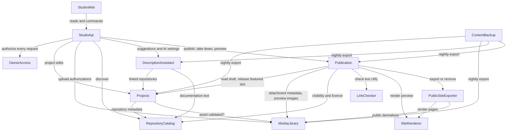

# Domain Design — Components

**Inputs:**
- requirements — `../requirements-analysis/requirements.md`, FR1–FR10 and NFR1–NFR17, including Amendment A1 to A1.2;
- team-practices — `../practices-discovery/team-practices.md`, as affirmed in `team.md` and `project.md`;
- the approved Refined Mockups, especially P4, the approved-publication snapshot;
- decisions D-01 to D-28 and P-01 to P-06;
- the answers in `domain-design-questions.md`.

The decisions behind this catalogue are ADR-001 to ADR-011 in `decisions.md`, and `traceability.json` maps every functional requirement to a component or entity.

This document names the **building blocks we write code for**. It does not decide deployment topology (Units Generation does), the tech stack beyond the charter's constraints, or NFR patterns (NFR Design and Infrastructure Design do). Databases, storage, the CDN, Auth0, GitHub and the AI provider appear only as external dependencies.

## Component Catalogue

```yaml
components:
  - name: StudioWeb
    summary: The owner's private Studio in the browser — projects, discover, editor, preview, publish, take-down, featured order, activity.
    behaviour: >
      Renders only after sign-in; holds no secrets and makes no authorization decision of its own (FR1.2).
      Warns before leaving the editor with unsaved changes (FR4.6) and keeps unsaved edits so they survive
      re-authentication (FR1.4; the storage mechanism is fixed in NFR Design). Shows the empty state with
      "New project" and "Discover a GitHub repository" (FR3.5), status words rather than colour alone,
      the "Preview — not public" marking (FR6.1), and the take-down notice that copies held elsewhere cannot be withdrawn (FR8.4).
      Escapes all owner and AI text (FR4.5). Uploads go directly to storage using authorizations from the API (FR4.8).
    responsibilities:
      - Studio screens S1–S9 as approved in Refined Mockups
      - Local unsaved-edit recovery and the leave guard
      - Direct-to-storage uploads using issued authorizations
    depends_on:
      - component: StudioApi
        interaction: every read and command; sign-in tokens are attached to each call
        style: sync
    dependents: []
    external_dependencies:
      - name: Auth0 (owner sign-in with MFA)
        kind: third-party-api
        purpose: Hosted sign-in and second factor; returns the token presented to the API
      - name: Private object storage
        kind: object-store
        purpose: Target of direct uploads made with a single-use upload authorization
    entities:
      - name: LocalEditDraft
        identifier: projectId
        attributes: [projectId, baseRevision, fieldValues, capturedAt]
        references:
          - entity: Project
            owned_by: Projects
            relationship: each local draft holds unsaved edits to one project at a known revision

  - name: StudioApi
    summary: The Studio's server boundary — authenticates every request, enforces rate limits, and routes to the domain components.
    behaviour: >
      No Studio operation runs without OwnerAccess confirming the caller is the owner (FR1.2, NFR1);
      a refused request returns 401 or 403 and changes nothing. Applies the NFR16 request-rate limits to
      AI suggestions, upload authorizations and the Publish/Update preparation that triggers link checks,
      returning 429 before any provider call, authorization or outbound request. Composes flows that
      span components so the dependency graph stays acyclic (ADR-011): Discover joins the repository
      list with project links; inserting a suggestion passes its recorded provenance to Projects.
      Serves preview only to the owner (FR6.2). Exposes the health endpoint used by smoke checks and
      logs errors with a request id and no secrets or personal data (NFR11).
    responsibilities:
      - Request authentication via OwnerAccess on every operation
      - Rate limits (NFR16), error mapping, request ids, health endpoint
      - Composition of cross-component Studio flows
    depends_on:
      - component: OwnerAccess
        interaction: verify the caller is the configured owner before any operation
        style: sync
      - component: Projects
        interaction: create, read, edit and list projects; link repositories; categories and featured line-up
        style: sync
      - component: MediaLibrary
        interaction: issue upload authorizations and confirm uploaded files
        style: sync
      - component: RepositoryCatalog
        interaction: list and search the owner's repositories for Discover
        style: sync
      - component: DescriptionAssistant
        interaction: request suggestions; read and change AI spend and provider approvals
        style: sync
      - component: Publication
        interaction: statuses, preview, Publish/Update preparation and confirmation, take-down, featured order, activity log
        style: sync
    dependents:
      - component: StudioWeb
        interaction: every Studio read and command
    external_dependencies: []
    entities: []

  - name: OwnerAccess
    summary: Decides whether a request comes from the single configured owner.
    behaviour: >
      Validates the identity token's signature, expiry, audience and issuer, then admits the caller only
      when both the issuer and the immutable subject ID equal the configured owner values (FR1.1).
      Email, display name and other user-editable claims never establish ownership. A look-alike account,
      a foreign issuer, or an expired or malformed token is refused. MFA is enforced at the identity provider
      (FR1.3); where the token carries second-factor evidence, OwnerAccess also requires it (mechanism fixed in NFR Design).
      Holds no data of its own; the owner identity values are configuration.
    responsibilities:
      - Token validation and owner matching
      - The single authorization rule used by every Studio operation
    depends_on: []
    dependents:
      - component: StudioApi
        interaction: authorize each Studio request
    external_dependencies:
      - name: Auth0 (issuer metadata and signing keys)
        kind: third-party-api
        purpose: Verify token signatures and the issuer
    entities: []

  - name: Projects
    summary: The owner's working record of every project and its exhibit draft.
    behaviour: >
      A project can be created with only a title (FR3.1) or from a repository; a repository already linked
      opens its project rather than creating a duplicate (FR2.3). Every save carries the revision it was
      based on, and a save based on an older revision is refused with a conflict (FR3.4). Each save
      increments the draft revision, which is all Publication needs to derive "Changes since last publish" (ADR-003).
      Holds the exhibit text (title, summary, six narrative sections), links, access metadata (live URL,
      access requirement, phone suitability; FR4.10), the "Rights review complete" and "Live URL authorized"
      flags (FR10.6, FR10.7), the images and attachments chosen for the exhibit with alt text and lead image,
      the primary category and featured flag (FR9.7, FR9.8), and the provenance of AI-inserted text (FR5.2, FR7.2).
      Accepts an image or attachment only after MediaLibrary confirms it passed validation (FR4.8).
      Enforces at most five featured projects, drafts included (FR9.7). No topic tags (FR4.7).
    responsibilities:
      - Project and exhibit draft lifecycle, with optimistic concurrency
      - Repository links, exhibit composition (images, alt text, lead, attachments)
      - Category reference data, category assignment, draft featured line-up
      - Rights-review and live-URL authorization flags
      - Provenance of AI-originated text
    depends_on:
      - component: RepositoryCatalog
        interaction: read repository metadata when creating a project from, or linking, a repository
        style: sync
      - component: MediaLibrary
        interaction: confirm an uploaded asset passed validation before attaching it to the exhibit
        style: sync
    dependents:
      - component: StudioApi
        interaction: project reads and edits
      - component: DescriptionAssistant
        interaction: read a project's linked repositories
      - component: Publication
        interaction: read the draft to prepare, preview and publish; release the featured slot on take-down
      - component: ContentBackup
        interaction: nightly export of project data
    external_dependencies:
      - name: MongoDB Atlas
        kind: database
        purpose: Project, draft and composition records
    entities:
      - name: Project
        identifier: projectId
        attributes: [projectId, title, revision, summary, narrativeSections, links, liveUrl, accessRequirement, phoneSuitability, rightsReview, liveUrlAuthorized, featured, createdAt, updatedAt]
      - name: RepositoryLink
        identifier: linkId
        attributes: [linkId, projectId, githubRepositoryId, nameAtLink, linkedAt]
      - name: ExhibitImage
        identifier: exhibitImageId
        attributes: [exhibitImageId, projectId, assetId, altText, caption, position, isLead]
        references:
          - entity: MediaAsset
            owned_by: MediaLibrary
            relationship: each exhibit image shows one validated image asset
      - name: ExhibitAttachment
        identifier: exhibitAttachmentId
        attributes: [exhibitAttachmentId, projectId, assetId, label, position]
        references:
          - entity: MediaAsset
            owned_by: MediaLibrary
            relationship: each exhibit attachment offers one validated file asset
      - name: Category
        identifier: categoryId
        attributes: [categoryId, slug, name, position]
      - name: CategoryAssignment
        identifier: assignmentId
        attributes: [assignmentId, projectId, categoryId, primary]
      - name: FeaturedLineup
        identifier: lineupId
        attributes: [lineupId, orderedProjectIds, revision]
      - name: TextProvenance
        identifier: provenanceId
        attributes: [provenanceId, projectId, field, suggestionId, providerId, sourceRepositoryIds, insertedAt]
        references:
          - entity: Suggestion
            owned_by: DescriptionAssistant
            relationship: each provenance record names the suggestion whose text the owner inserted

  - name: MediaLibrary
    summary: Owns every uploaded byte — authorization, validation, conversion, private originals and metadata-free public derivatives.
    behaviour: >
      Issues short-lived, single-use upload authorizations to the owner only, with the size limit and allowed
      type bound in (FR4.8). After upload it validates content by file signature, never by name or declared type:
      images JPEG, PNG, WebP, HEIC/HEIF up to 10 MB, with the pixel limit checked before any full decode and decoding
      under memory and time limits; HEIC keeps only the oriented primary image (FR4.2). Attachments PDF, SKP, FCStd,
      DXF, STL, ZIP, VSDX up to 50 MB; ZIP-based checks read only the central directory and the named entry, enforce
      uncompressed-size and ratio limits, never extract to disk, and parse XML with DTDs and external entities disabled (FR4.4).
      Extracts attachment metadata and ZIP entry lists under the same limits, reporting "could not be read" on failure (FR7.2).
      Produces public derivatives only on request from export: images re-encoded with all metadata removed (FR4.2).
      Originals never leave private storage (FR4.9, NFR2). A security-sensitive path (team practice).
    responsibilities:
      - Upload authorization and post-upload content validation
      - HEIC conversion, decode limits, archive and XML safety checks
      - Attachment metadata and entry listing for the Publish confirmation
      - Metadata-free public image derivatives; private originals
    depends_on: []
    dependents:
      - component: StudioApi
        interaction: issue upload authorizations; report validation results
      - component: Projects
        interaction: confirm an asset is validated before it is attached
      - component: Publication
        interaction: attachment metadata for the confirmation; owner-only preview image addresses
      - component: PublicSiteExporter
        interaction: metadata-free image derivatives and attachment bytes for export
      - component: ContentBackup
        interaction: nightly export of asset records
    external_dependencies:
      - name: Private object storage (versioned)
        kind: object-store
        purpose: Originals and derivatives; never an origin of the public site (NFR2, NFR10)
      - name: MongoDB Atlas
        kind: database
        purpose: Asset and upload-authorization records
      - name: Image and archive decoding libraries
        kind: other
        purpose: Signature checks, HEIC conversion, re-encoding, safe ZIP and XML reading
    entities:
      - name: MediaAsset
        identifier: assetId
        attributes: [assetId, projectId, kind, detectedType, byteSize, pixelWidth, pixelHeight, originalKey, derivativeKeys, validationStatus, documentMetadata, archiveEntries, uploadedAt]
        references:
          - entity: Project
            owned_by: Projects
            relationship: each asset was uploaded for one project
      - name: UploadAuthorization
        identifier: authorizationId
        attributes: [authorizationId, projectId, kind, allowedType, maxBytes, objectKey, expiresAt, usedAt]
        references:
          - entity: Project
            owned_by: Projects
            relationship: each authorization permits one upload for one project

  - name: RepositoryCatalog
    summary: Read-only view of the owner's GitHub repositories — listing, metadata, visibility, licence and documentation text.
    behaviour: >
      Uses only a read-only credential scoped to the owner's repositories and to metadata, README and documentation
      files (FR2.2); it has no write path, so discovery or linking can never change a repository or publish anything (FR2.5).
      Lists repositories with name, visibility as text, last-updated date, searchable by name (FR2.1). Reports
      visibility as public, private or unconfirmed: any error, rate limit or rename yields "unconfirmed", which
      callers treat as private (FR4.10 fail closed). Reports GitHub being unreachable as a distinct, retryable
      condition (FR2.4). Returns documentation text to the description assistant marked as untrusted (FR5.6). Stores nothing.
    responsibilities:
      - Repository listing and search
      - Visibility and licence facts, failing closed
      - Documentation text retrieval for AI evidence
    depends_on: []
    dependents:
      - component: StudioApi
        interaction: Discover listing and search
      - component: Projects
        interaction: repository metadata when linking
      - component: DescriptionAssistant
        interaction: README and documentation files of linked repositories
      - component: Publication
        interaction: visibility and licence read at Publish and Update
    external_dependencies:
      - name: GitHub API
        kind: third-party-api
        purpose: Repository metadata, visibility, licence, documentation files
      - name: AWS SSM Parameter Store
        kind: other
        purpose: Read-only GitHub credential (NFR3)
    entities: []

  - name: DescriptionAssistant
    summary: Drafts exhibit text from a project's linked repositories, behind a provider-independent port and the owner's spending and privacy approvals.
    behaviour: >
      Offers suggestions only for a project with at least one linked repository (FR5.1). Before any provider call
      it checks, in order: the owner has approved AI spending and this month's limit is not reached (FR5.8);
      if any source repository is private or unconfirmed, the configured provider is approved for private content (FR5.9).
      Repository text is delimited as untrusted data, cannot alter the instructions, and the model has no tools (FR5.6).
      Each suggestion records its source files, source repositories and the provider used (FR5.2, FR5.9) and never
      changes exhibit text itself. A failure, a 60-second timeout or malformed output yields "No suggestion this time"
      with no change (FR5.7). Provider credentials are read server-side only (FR5.5). Providers are adapters behind
      one port, so they can be swapped by configuration (FR5.4); which provider and framework is fixed in NFR Design.
    responsibilities:
      - Suggestion generation through a provider-independent port
      - Spend approval, monthly limit, provider approval for private content
      - Suggestion records with sources and provider
    depends_on:
      - component: Projects
        interaction: find the project's linked repositories
        style: sync
      - component: RepositoryCatalog
        interaction: fetch documentation text and visibility of those repositories
        style: sync
    dependents:
      - component: StudioApi
        interaction: suggestion requests and AI settings
      - component: ContentBackup
        interaction: nightly export of suggestions and AI settings
    external_dependencies:
      - name: AI provider API (chosen in NFR Design)
        kind: third-party-api
        purpose: Generate suggestion text
      - name: AWS SSM Parameter Store
        kind: other
        purpose: Provider credentials (FR5.5, NFR3)
      - name: MongoDB Atlas
        kind: database
        purpose: Suggestions, approvals, usage counts
    entities:
      - name: Suggestion
        identifier: suggestionId
        attributes: [suggestionId, projectId, providerId, sourceFiles, sourceRepositoryIds, includesPrivateContent, text, outcome, createdAt]
        references:
          - entity: Project
            owned_by: Projects
            relationship: each suggestion was drafted for one project
      - name: AiSpendPolicy
        identifier: policyId
        attributes: [policyId, spendApproved, monthlyLimit, approvedAt]
      - name: AiProviderApproval
        identifier: providerId
        attributes: [providerId, approvedForPrivateContent, dataUseTermsReference, approvedAt]
      - name: AiUsageMonth
        identifier: month
        attributes: [month, suggestionCount]

  - name: LinkChecker
    summary: Checks whether one live URL is reachable, under the NFR17 SSRF rules, and returns a result without storing anything.
    behaviour: >
      Accepts one https URL on port 443 without userinfo or non-canonical IP literals, parsed by one canonical parser.
      Connects only to globally routable unicast addresses (IANA special-purpose registries as an allow-list,
      IPv4-mapped forms normalized; any refused address refuses the URL), pins the validated address, keeps TLS
      validation with the original hostname, re-validates every redirect (at most 3), uses GET or HEAD with identity
      encoding, 5 s per hop, 15 s overall, 256 KB read after decoding, never renders or loads subresources, and sends
      no credentials (NFR17). Returns exactly one label — "Reachable", "Not reachable" or "Refused (non-public address)" —
      with the sanitized final address and whether a sign-in page was detected (FR10.5). Logs host, address, decision and
      reason, never the body. Has no database, secret or private-network access (ADR-005).
    responsibilities:
      - SSRF-safe reachability check of one URL
      - Result labels and sign-in detection
    depends_on: []
    dependents:
      - component: Publication
        interaction: check the exhibit's live URL when Publish or Update is opened
    external_dependencies:
      - name: Public internet and DNS
        kind: other
        purpose: Resolve and request the owner-entered URL
    entities: []

  - name: Publication
    summary: The only path to the public site — prepares and records the owner's confirmation, freezes approved published versions, runs publish, update, take-down and featured-order operations one at a time, and keeps the activity log.
    behaviour: >
      Derives each project's status from its draft revision and its publication record (ADR-003; FR3.2, FR7.5).
      Preparing Publish or Update builds the full inventory (FR7.2): text sections, AI-originated text, images,
      included files with their metadata and ZIP entries, links, live-URL check result (via LinkChecker, one URL
      per exhibit), repository visibility and licence read now (unconfirmed treated as private), any private repository
      that informed the text, featured status, primary category, outstanding rights review or unauthorized live URL.
      It blocks Publish when the title is empty, there is no lead image, an image lacks alt text, or a rights review
      is outstanding (FR7.3, FR10.6). On confirmation it freezes a PublishedVersion holding only the allow-listed public
      fields (FR4.10): derived badges, the owner-included live URL only if authorized where required (FR10.7),
      and repositories confirmed public with licence. Private repository names never enter it (FR4.3, D-15).
      Operations for one exhibit run one at a time in confirmation order, are idempotent under retries and double
      clicks, and leave the public state equal to the last successful action (FR7.6, FR7.8; ADR-004).
      Take-down releases the featured slot in Projects (FR8.2). "Update featured order" is its own operation (FR9.7).
      Preview renders a candidate version built by the same projection, marked "Preview — not public", for the owner only (FR6).
      A candidate becomes eligible only with its content, rights, live-URL and publication approvals (FR10.1).
      Records every publish, update, take-down and featured-order change in the activity log (FR7.7).
    responsibilities:
      - Publish/Update preparation, blockers and confirmation inventory
      - The approved-publication snapshot (PublishedVersion) and its allow-list projection
      - Serialized, idempotent publication operations; take-down; featured order
      - Status derivation, owner-only preview, activity log
    depends_on:
      - component: Projects
        interaction: read the draft and its composition; release the featured slot on take-down
        style: sync
      - component: MediaLibrary
        interaction: attachment metadata and entries for the inventory; owner-only preview image addresses
        style: sync
      - component: RepositoryCatalog
        interaction: read visibility and licence at Publish and Update
        style: sync
      - component: LinkChecker
        interaction: check the live URL when the confirmation is prepared
        style: sync
      - component: SiteRenderer
        interaction: render the owner-only preview from a candidate version
        style: sync
      - component: PublicSiteExporter
        interaction: export or remove public pages and assets inside a running publication operation
        style: sync
    dependents:
      - component: StudioApi
        interaction: statuses, preview, preparation, confirmation, take-down, featured order, activity
      - component: ContentBackup
        interaction: nightly export of publication records and the activity log
    external_dependencies:
      - name: MongoDB Atlas
        kind: database
        purpose: Publication records, versions, operations, activity log
    entities:
      - name: PublicationRecord
        identifier: projectId
        attributes: [projectId, state, currentVersionId, lastOperationId]
        references:
          - entity: Project
            owned_by: Projects
            relationship: each project has at most one publication record
      - name: PublishedVersion
        identifier: versionId
        attributes: [versionId, projectId, sourceRevision, title, summary, narrativeSections, images, attachments, links, liveUrl, badges, publicRepositories, primaryCategory, featured, confirmedAt]
        references:
          - entity: Project
            owned_by: Projects
            relationship: each published version is a frozen, allow-listed projection of one project revision
      - name: PublicationOperation
        identifier: operationId
        attributes: [operationId, projectId, kind, idempotencyKey, confirmationInventory, status, requestedAt, completedAt, failureReason]
      - name: LinkCheckRecord
        identifier: checkId
        attributes: [checkId, projectId, requestedUrl, label, finalAddress, signInDetected, crossDomainRedirect, checkedAt]
      - name: PublishedFeaturedOrder
        identifier: orderId
        attributes: [orderId, orderedProjectIds, publishedAt]
      - name: ActivityEntry
        identifier: entryId
        attributes: [entryId, at, projectId, action, outcome, operationId]

  - name: SiteRenderer
    summary: Turns a public site model into the public pages — home, catalog, category, exhibit and not-on-display — with no access to Studio data.
    behaviour: >
      A pure transformation: input is a public site model made only of PublishedVersions and the published featured
      order (or one candidate version for preview); output is pages and their client assets. Home shows the featured
      carousel only when a published exhibit is featured, then categories with published exhibits, then the gallery
      (FR9.1); exhibit pages omit absent blocks (FR9.2); unknown or empty addresses get the not-on-display pages (FR9.3,
      FR9.8). Footer with GitHub, a plain email link and copyright (FR9.4). All text is escaped (FR4.5). No third-party
      origin, inline script or tracking (FR9.5, NFR9, NFR15). Implements the approved crafted-studio tokens and the
      accessible, non-auto-advancing carousel (FR9.6, FR9.7, NFR8). Preview adds the permanent "Preview — not public" marking (FR6.1).
    responsibilities:
      - Public page templates and client assets
      - Category, featured, gallery and badge presentation
      - Preview rendering with the preview marking
    depends_on: []
    dependents:
      - component: Publication
        interaction: render the owner-only preview
      - component: PublicSiteExporter
        interaction: render pages to publish
    external_dependencies: []
    entities: []

  - name: PublicSiteExporter
    summary: Writes rendered pages and approved assets to public storage, removes withdrawn content, and invalidates the CDN.
    behaviour: >
      Runs only inside a Publication operation and receives the full public site model built from last-published state,
      so unpublished changes to any exhibit never appear (FR7.4). Writes the exhibit page, card data, its carousel slide when
      featured, its category page and the home page; copies only images and files included in published versions, taking
      images as metadata-free derivatives from MediaLibrary (FR4.2) and serving files as downloads with the fixed content type,
      attachment disposition, nosniff and sandbox policy (FR4.4, FR4.9). Take-down deletes the exhibit's page, card and assets,
      updates the carousel, category pages and counts, removes an emptied category so its address returns 404, and invalidates
      the cache (FR8.2). Keeps a record of the objects each page set produced so removal is exact and re-export idempotent (FR7.6).
      Writes nowhere but public storage; never reads Studio data directly.
    responsibilities:
      - Public storage writes and deletions; CDN invalidation
      - Exact removal on take-down; idempotent re-export
      - Download response settings for attachments
    depends_on:
      - component: SiteRenderer
        interaction: render the pages to write
        style: sync
      - component: MediaLibrary
        interaction: metadata-free image derivatives and included attachment bytes
        style: sync
    dependents:
      - component: Publication
        interaction: export or remove content during a publication operation
    external_dependencies:
      - name: Public object storage
        kind: object-store
        purpose: The static public site
      - name: CDN
        kind: other
        purpose: Serve the public site; invalidate changed paths within 5 minutes
    entities:
      - name: ExportedObjectSet
        identifier: targetKey
        attributes: [targetKey, objectKeys, contentHash, sourceVersionIds, exportedAt]
        references:
          - entity: PublishedVersion
            owned_by: Publication
            relationship: each exported object set was rendered from one or more published versions

  - name: ContentBackup
    summary: Nightly export of Studio content to private versioned storage, and its documented restore.
    behaviour: >
      Once a night, asks each owning component for its records and writes one export to private, versioned,
      encrypted storage that blocks all public access and is never an origin of the public site (NFR10, NFR2).
      Uploaded files are already in versioned storage and are not copied again. A failed run is logged and retried
      the next night; restore is documented and tested once before launch.
    responsibilities:
      - Nightly content export and restore procedure
    depends_on:
      - component: Projects
        interaction: export project records
        style: sync
      - component: MediaLibrary
        interaction: export asset records
        style: sync
      - component: DescriptionAssistant
        interaction: export suggestions and AI settings
        style: sync
      - component: Publication
        interaction: export publication records and the activity log
        style: sync
    dependents: []
    external_dependencies:
      - name: Private object storage (versioned, encrypted)
        kind: object-store
        purpose: Nightly exports
      - name: Scheduler
        kind: other
        purpose: Starts the nightly run
    entities:
      - name: BackupRun
        identifier: runId
        attributes: [runId, startedAt, completedAt, objectKey, outcome]
```

## Component Diagram



Text fallback, in call order:

- StudioWeb → StudioApi.
- StudioApi → OwnerAccess, Projects, MediaLibrary, RepositoryCatalog, DescriptionAssistant and Publication.
- Projects → RepositoryCatalog and MediaLibrary.
- DescriptionAssistant → Projects and RepositoryCatalog.
- Publication → Projects, MediaLibrary, RepositoryCatalog, LinkChecker, SiteRenderer and PublicSiteExporter.
- PublicSiteExporter → SiteRenderer and MediaLibrary.
- ContentBackup → Projects, MediaLibrary, DescriptionAssistant and Publication.

The graph is acyclic. The only path from the Studio to public storage runs through Publication, then PublicSiteExporter.

## Component Summary

| Component | Purpose | Depends On | Dependents | Entities Owned |
|---|---|---|---|---|
| StudioWeb | Owner's Studio in the browser | StudioApi | — | LocalEditDraft |
| StudioApi | Server boundary: owner check, rate limits, routing, composition | OwnerAccess, Projects, MediaLibrary, RepositoryCatalog, DescriptionAssistant, Publication | StudioWeb | — |
| OwnerAccess | Is this the configured owner? | — | StudioApi | — |
| Projects | Projects and exhibit drafts | RepositoryCatalog, MediaLibrary | StudioApi, DescriptionAssistant, Publication, ContentBackup | Project, RepositoryLink, ExhibitImage, ExhibitAttachment, Category, CategoryAssignment, FeaturedLineup, TextProvenance |
| MediaLibrary | Uploaded bytes: validation, originals, derivatives | — | StudioApi, Projects, Publication, PublicSiteExporter, ContentBackup | MediaAsset, UploadAuthorization |
| RepositoryCatalog | Read-only GitHub view, failing closed | — | StudioApi, Projects, DescriptionAssistant, Publication | — |
| DescriptionAssistant | AI drafts behind spend and privacy approvals | Projects, RepositoryCatalog | StudioApi, ContentBackup | Suggestion, AiSpendPolicy, AiProviderApproval, AiUsageMonth |
| LinkChecker | SSRF-safe reachability, stateless | — | Publication | — |
| Publication | The only path to public: confirmation, snapshot, operations, activity | Projects, MediaLibrary, RepositoryCatalog, LinkChecker, SiteRenderer, PublicSiteExporter | StudioApi, ContentBackup | PublicationRecord, PublishedVersion, PublicationOperation, LinkCheckRecord, PublishedFeaturedOrder, ActivityEntry |
| SiteRenderer | Public pages from a public site model | — | Publication, PublicSiteExporter | — |
| PublicSiteExporter | Public storage writes, removal, CDN invalidation | SiteRenderer, MediaLibrary | Publication | ExportedObjectSet |
| ContentBackup | Nightly content export and restore | Projects, MediaLibrary, DescriptionAssistant, Publication | — | BackupRun |

## Entity Ownership

| Entity | Owning Component | Identifier | Attributes | References |
|---|---|---|---|---|
| LocalEditDraft | StudioWeb | projectId | projectId, baseRevision, fieldValues, capturedAt | Project (Projects) |
| Project | Projects | projectId | projectId, title, revision, summary, narrativeSections, links, liveUrl, accessRequirement, phoneSuitability, rightsReview, liveUrlAuthorized, featured, createdAt, updatedAt | — |
| RepositoryLink | Projects | linkId | linkId, projectId, githubRepositoryId, nameAtLink, linkedAt | — |
| ExhibitImage | Projects | exhibitImageId | exhibitImageId, projectId, assetId, altText, caption, position, isLead | MediaAsset (MediaLibrary) |
| ExhibitAttachment | Projects | exhibitAttachmentId | exhibitAttachmentId, projectId, assetId, label, position | MediaAsset (MediaLibrary) |
| Category | Projects | categoryId | categoryId, slug, name, position | — |
| CategoryAssignment | Projects | assignmentId | assignmentId, projectId, categoryId, primary | — |
| FeaturedLineup | Projects | lineupId | lineupId, orderedProjectIds, revision | — |
| TextProvenance | Projects | provenanceId | provenanceId, projectId, field, suggestionId, providerId, sourceRepositoryIds, insertedAt | Suggestion (DescriptionAssistant) |
| MediaAsset | MediaLibrary | assetId | assetId, projectId, kind, detectedType, byteSize, pixelWidth, pixelHeight, originalKey, derivativeKeys, validationStatus, documentMetadata, archiveEntries, uploadedAt | Project (Projects) |
| UploadAuthorization | MediaLibrary | authorizationId | authorizationId, projectId, kind, allowedType, maxBytes, objectKey, expiresAt, usedAt | Project (Projects) |
| Suggestion | DescriptionAssistant | suggestionId | suggestionId, projectId, providerId, sourceFiles, sourceRepositoryIds, includesPrivateContent, text, outcome, createdAt | Project (Projects) |
| AiSpendPolicy | DescriptionAssistant | policyId | policyId, spendApproved, monthlyLimit, approvedAt | — |
| AiProviderApproval | DescriptionAssistant | providerId | providerId, approvedForPrivateContent, dataUseTermsReference, approvedAt | — |
| AiUsageMonth | DescriptionAssistant | month | month, suggestionCount | — |
| PublicationRecord | Publication | projectId | projectId, state, currentVersionId, lastOperationId | Project (Projects) |
| PublishedVersion | Publication | versionId | versionId, projectId, sourceRevision, title, summary, narrativeSections, images, attachments, links, liveUrl, badges, publicRepositories, primaryCategory, featured, confirmedAt | Project (Projects) |
| PublicationOperation | Publication | operationId | operationId, projectId, kind, idempotencyKey, confirmationInventory, status, requestedAt, completedAt, failureReason | — |
| LinkCheckRecord | Publication | checkId | checkId, projectId, requestedUrl, label, finalAddress, signInDetected, crossDomainRedirect, checkedAt | — |
| PublishedFeaturedOrder | Publication | orderId | orderId, orderedProjectIds, publishedAt | — |
| ActivityEntry | Publication | entryId | entryId, at, projectId, action, outcome, operationId | — |
| ExportedObjectSet | PublicSiteExporter | targetKey | targetKey, objectKeys, contentHash, sourceVersionIds, exportedAt | PublishedVersion (Publication) |
| BackupRun | ContentBackup | runId | runId, startedAt, completedAt, objectKey, outcome | — |

Some project identifiers are held as plain values, without a declared cross-component reference, because they are only labels within the owning component's own records:
- `projectId` in PublicationOperation, LinkCheckRecord and ActivityEntry;
- `orderedProjectIds` in FeaturedLineup and PublishedFeaturedOrder.

Functional Design fixes their types and constraints.

## External Dependencies

| Component | Dependency | Kind | Purpose |
|---|---|---|---|
| StudioWeb | Auth0 | third-party-api | Owner sign-in with MFA |
| StudioWeb | Private object storage | object-store | Direct uploads with single-use authorizations |
| OwnerAccess | Auth0 issuer metadata and signing keys | third-party-api | Token verification |
| Projects | MongoDB Atlas | database | Projects, drafts, composition |
| MediaLibrary | Private object storage (versioned) | object-store | Originals and derivatives, never public |
| MediaLibrary | MongoDB Atlas | database | Asset and authorization records |
| MediaLibrary | Image and archive decoding libraries | other | Validation, conversion, re-encoding |
| RepositoryCatalog | GitHub API | third-party-api | Repository facts and documentation |
| RepositoryCatalog | AWS SSM Parameter Store | other | Read-only GitHub credential |
| DescriptionAssistant | AI provider API | third-party-api | Suggestion text (provider chosen in NFR Design) |
| DescriptionAssistant | AWS SSM Parameter Store | other | Provider credentials |
| DescriptionAssistant | MongoDB Atlas | database | Suggestions, approvals, usage |
| LinkChecker | Public internet and DNS | other | The URL being checked |
| Publication | MongoDB Atlas | database | Publication records, versions, operations, activity |
| PublicSiteExporter | Public object storage | object-store | The static public site |
| PublicSiteExporter | CDN | other | Delivery and invalidation |
| ContentBackup | Private object storage (versioned, encrypted) | object-store | Nightly exports |
| ContentBackup | Scheduler | other | Nightly trigger |

## Rationale

| Component | Why it is a separate building block |
|---|---|
| StudioWeb | Distinct runtime (the owner's browser) and change rate (Studio UI). It holds only the owner's local unsaved edits. |
| StudioApi | The single server-side enforcement point for "every Studio operation is the owner's" (FR1.2), with rate limits and composition. Keeping this apart from domain logic lets the invariant test target one place. |
| OwnerAccess | A security-sensitive rule with its own invariants (issuer plus subject, never email) and change driver (the identity provider). It needs an independent security review (team practice), so it is kept small. |
| Projects | Owns the owner's working data and changes with the editor. Distinct from Publication, so drafts and approved versions never share a record. |
| MediaLibrary | Untrusted-file handling with its own limits, libraries and security review. It is the only component that touches uploaded bytes. |
| RepositoryCatalog | Isolates the GitHub credential and its read-only scope, and the fail-closed visibility rule, behind one boundary. |
| DescriptionAssistant | Distinct concern (AI), with its own approvals (spend, private content) and a provider port that must stay swappable. |
| LinkChecker | NFR17 requires an execution identity with no other permissions. Only a stateless component with no dependencies can run that way. |
| Publication | The publication boundary (NFR2). Every route to the public site passes through its confirmation and its allow-list projection. |
| SiteRenderer | Changes with the visual design (FR9.6), not with workflow rules. Export and preview share it, which guarantees they look identical (FR6.1). It has no Studio data access. |
| PublicSiteExporter | The only writer to public storage and the CDN. Its infrastructure side effects are kept apart from the pure renderer and the workflow rules. |
| ContentBackup | Distinct lifecycle (scheduled), distinct storage and a documented restore. It reads through the owners' exports so ownership stays intact. |

### Component-boundary options

The decomposition has more than one viable shape. ADR-001 records the choice.

- **Option A — Domain components in one modular monolith (recommended; catalogued above).**
  - Pros:
    - each security invariant has one owner and one test target: owner access, upload validation, SSRF, the publication boundary;
    - preview and export share a renderer;
    - the public site never shares code paths with draft data.
  - Cons: twelve components to keep tidy, and some calls are composed in StudioApi to stay acyclic.
  - Reversibility: high. These are modules, not deployables, so Units Generation can group them freely, and merging two modules later is cheap.
- **Option B — Three coarse components** (Studio back end, public site, Studio web client).
  - Pros: fewer boundaries; quick to start.
  - Cons:
    - the publication boundary, the upload path, the link checker's isolation and the owner check all sit inside one large component, so they cannot be reviewed or isolated individually;
    - the link checker cannot get a zero-permission identity;
    - drafts and published content share one model, the failure the owner rejected in the prototype on 2026-10-11.
  - Reversibility: splitting later is costly once data and call paths are entangled.
- **Option C — One component per screen or endpoint.**
  - Pros: maps directly to the UI.
  - Cons: entity ownership becomes ambiguous (several screens edit a project), and rules such as status and the allow-list end up duplicated.
  - Reversibility: medium.

**Recommendation:** Option A. The requirements put most of their weight on four boundaries: owner-only access, untrusted uploads, SSRF-safe checks, and nothing public without approval. Option A gives each of them exactly one component, and its reversibility stays high because grouping into deployables is still open. Michael confirms or changes this at the Domain Design gate.

**Alternatives Rejected:** Option B and Option C, for the reasons above; see ADR-001.

## Assumptions & Open Questions

- **Deployment grouping is open.** Units Generation decides which components share a deployable. NFR17's isolation rule means LinkChecker must be deployable on its own execution identity, whatever else is grouped.
- **Edit recovery for FR1.4** is modelled as a local draft in StudioWeb. If NFR Design chooses server-side recovery, the entity moves to Projects; no other component changes.
- **Media decoding isolation:** decoding untrusted files may also get its own execution identity. NFR Design decides.
- **Contract shapes are not fixed here:**
  - the public site model;
  - the confirmation inventory;
  - operation results.

  Contract Design and Functional Design fix them, together with field types and validation.
- **Withheld-value CI check:** the check from FR10.7 is pipeline tooling, not a runtime component. It is designed in the CI Pipeline stage.
