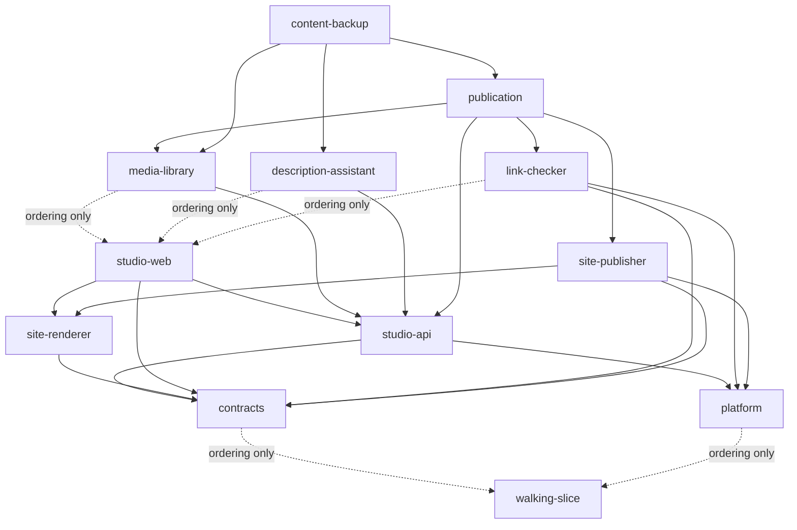

# Unit Dependencies

**Inputs:**
- the units in `unit-of-work.md`;
- the component dependencies in `../domain-design/components.md`;
- the decisions in `../domain-design/decisions.md`;
- the requirements in `../requirements-analysis/requirements.md`.

This document gives topology: what depends on what. It recommends no critical path. The only build order it encodes is through the five ordering-only edges of Amendment D1, which Michael approved as a Delivery Planning decision. Delivery Planning makes every other sequencing choice.

"A depends on B" means A cannot be completed and integrated without B's contract or code, or without the package or foundation B hosts.

**Amendment D1 (2026-10-11), approved by Michael at the Delivery Planning gate.** This adds the delivery-only unit `walking-slice` (U0) and five **ordering-only** edges. An edge marked ordering-only fixes the build order only, so the slice is built first and the Studio before media-library, description-assistant and link-checker. It carries no integration dependency. The 11 original units, their components and their contracts are unchanged.

## Dependency Graph

```yaml
units:
  - name: walking-slice
    kind: service
    depends_on: []
  - name: contracts
    kind: spec
    depends_on: [walking-slice]
  - name: platform
    kind: packaging
    depends_on: [walking-slice]
  - name: studio-api
    kind: service
    depends_on: [contracts, platform]
  - name: site-renderer
    kind: library
    depends_on: [contracts]
  - name: studio-web
    kind: ui
    depends_on: [contracts, studio-api, site-renderer]
  - name: media-library
    kind: service
    depends_on: [studio-api, studio-web]
  - name: description-assistant
    kind: library
    depends_on: [studio-api, studio-web]
  - name: link-checker
    kind: service
    depends_on: [contracts, platform, studio-web]
  - name: site-publisher
    kind: service
    depends_on: [contracts, platform, site-renderer]
  - name: publication
    kind: service
    depends_on: [studio-api, media-library, link-checker, site-publisher]
  - name: content-backup
    kind: service
    depends_on: [publication, description-assistant, media-library]
```



Text fallback, as "unit → what it depends on". **(o)** marks an ordering-only edge.
- **walking-slice** → nothing.
- **contracts** → walking-slice (o).
- **platform** → walking-slice (o).
- **studio-api** → contracts and platform.
- **site-renderer** → contracts.
- **studio-web** → contracts, studio-api and site-renderer.
- **media-library** → studio-api, and studio-web (o).
- **description-assistant** → studio-api, and studio-web (o).
- **link-checker** → contracts and platform, and studio-web (o).
- **site-publisher** → contracts, platform and site-renderer.
- **publication** → studio-api, media-library, link-checker and site-publisher.
- **content-backup** → publication, description-assistant and media-library.

The graph is acyclic.

## Why Each Edge Exists

| Unit | Depends on | Reason |
|---|---|---|
| contracts | walking-slice | **Ordering-only** (D1): builds the slice first. The slice consumes the approved C2 schema, so no integration dependency runs this way |
| platform | walking-slice | **Ordering-only** (D1): builds the slice first |
| media-library | studio-web | **Ordering-only** (D1): builds the Studio earlier |
| description-assistant | studio-web | **Ordering-only** (D1): builds the Studio earlier |
| link-checker | studio-web | **Ordering-only** (D1): builds the Studio earlier |
| studio-api | contracts | Implements the Studio API description |
| studio-api | platform | Deploys into the shared API entry point, database, parameters and roles |
| media-library | studio-api | Its module lives in the back-end package; Projects and StudioApi call it (attach check, upload authorization). Its isolated function deploys into U2's foundation, a dependency it reaches through studio-api |
| description-assistant | studio-api | Embedded module; reads linked repositories through Projects and RepositoryCatalog |
| link-checker | contracts | Implements the link-check request and result |
| link-checker | platform | Its isolated function and zero-permission identity sit in the shared foundation |
| site-renderer | contracts | Renders the versioned public site snapshot schema |
| site-publisher | contracts | Validates the publish request and the snapshot |
| site-publisher | platform | Writes public storage, invalidates the CDN, keeps its fence in a private store |
| site-publisher | site-renderer | Generates the static pages |
| publication | studio-api | Same package and database; ADR-012 guards and the take-down slot release in Projects |
| publication | media-library | Attachment metadata for the inventory; derivative keys for the asset-copy manifest; preview image addresses |
| publication | link-checker | Checks the live URL during preparation |
| publication | site-publisher | Runs each sequenced export, restore or removal |
| content-backup | publication | Exports publication records and the activity log |
| content-backup | description-assistant | Exports suggestions and AI settings |
| content-backup | media-library | Exports asset records |
| studio-web | contracts | Calls the Studio API through its description |
| studio-web | studio-api | Needs real owner sign-in and sessions to integrate |
| studio-web | site-renderer | Renders the owner-only preview (constraint 3 in `unit-of-work.md`) |

ContentBackup's dependency on Projects is reached through studio-api, via publication.

## Integration Points

| Between | Mechanism | Contract (U1) | Notes |
|---|---|---|---|
| U11 → U3, U4, U5, U9 | HTTPS, owner token | Studio API (OpenAPI) | Every route requires the owner except `GET /health` |
| U3 ↔ U4, U5, U9, U10 | In-process module interfaces | Module interfaces, Python | Same package and database. ADR-012 acceptance and commit run as one transaction across Projects and Publication records |
| U9 → U6 | Invoke function | Link-check request and result | U6 holds no data; U9 stores the LinkCheckRecord |
| U9 → U8 | Invoke function, one call per attempt | Publish request with a versioned snapshot | U9 validates before sending; U8 validates on receipt. U8 refuses a lower fencing token. U9 commits only if its token still holds the lease |
| U8 → U7 | In-process library call | Snapshot schema | Pure rendering, no input/output |
| U9 → U11 | Studio API, owner token | Preview payload: candidate snapshot plus a separate image-address map | The map holds owner-only, short-lived addresses, outside the snapshot |
| U11 → U7 | In-browser library call | Snapshot schema and asset resolver | Rendered into a sandboxed frame, never written to storage. Node/browser parity is tested |
| U4 upload processor → U4 module | Result record object in a private prefix | Upload processing result | The isolated function has no database access; the module ingests the record |
| U4 upload processor | Storage upload event | Upload processing result | Isolated function, triggered by the upload |
| U8 → private derivatives | Storage read of manifest-listed keys | Asset-copy manifest | Only keys named by U9 for this snapshot |
| U10 → owners | In-process export functions | Module interfaces | Writes private, versioned storage |

Runtime calls inside the back-end package also run from U3 to U4, U5 and U9. They go through U1 module interfaces and route registration, so they add no edge. See "Call Direction Inside the Back End" in `unit-of-work.md`.

## Parallel Development Opportunities

Units with no dependency path between them are independent, and can be worked on at the same time against U1's contracts, with fakes where needed (team practice: parallel agents on isolated branches). Ordering-only edges count as paths here. Mutually independent sets include:

- {contracts, platform};
- {studio-api, site-renderer};
- {media-library, description-assistant, link-checker, site-publisher}.

The approved delivery plan builds one unit at a time (unit-major, serial).

Many topological orders are valid. Delivery Planning chooses among them and decides what comes first.

## Assumptions & Open Questions

- Deployment wiring (queue, scheduler, events) is confirmed in NFR Design and Infrastructure Design.
- **Edge types.** Edges are integration dependencies, except the five marked ordering-only (D1). Units may start earlier against U1 contracts and fakes, as team practice allows.
